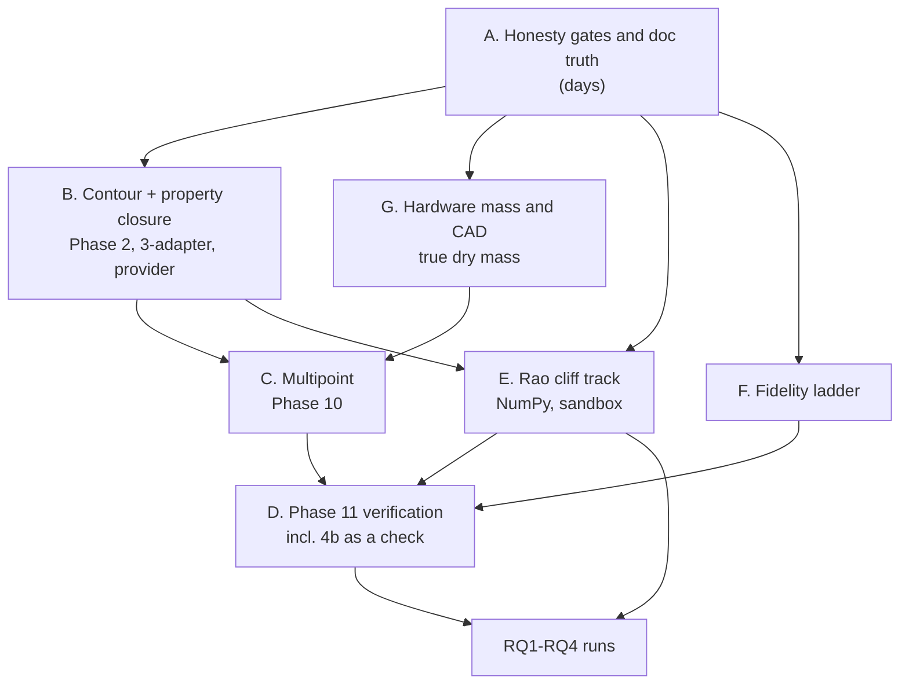

# Completion plan

> **What this document is.** One consolidated, deduplicated backlog covering
> *everything* left across the four separate plans in this repository, ordered
> into tracks with acceptance gates. It does not restate physics that
> `DIFFERENTIABLE_ENGINE_MDO_PLAN.md` already carries; it says what is left,
> in what order, gated how, and grounded in which source.

## 0. Scope decisions (fixed 2026-08-17)

1. **Everything.** All four backlogs are in scope: the MDO plan §11 remainder,
   the Paper-2 / Rao-cliff track, the remediation leftovers, and the physics
   fidelity roadmap.
2. **End state: a general-purpose design tool that can also answer RQ1–RQ4.**
   Tool completeness leads; the research questions are run on top of the
   finished tool rather than racing ahead of it. Practical consequence: the
   *whole-engine dry mass* gap (Track 2) is promoted, because a design tool that
   optimizes a partial mass subtotal is not a design tool.
3. **Phase 4b (Pizzarelli quasi-2-D) is post-optimum verification only.** The
   differentiable core stays at 1-D + fin. The quasi-2-D solve runs at Phase 11
   on the candidate optimum and *reports the delta*. This is the cheapest option
   and it directly discharges the plan's own "optimizer exploits model error"
   risk (§11 closing note).

### 0.1 Rules carried forward

Every invariant in `DIFFERENTIABLE_ENGINE_MDO_PLAN.md` §0.1 still binds. Three
additional rules govern this plan specifically:

- **A fidelity gap must be visible as `unknown`, never absorbed into a passing
  number.** (Inherited from the remediation work; it is why several items below
  are "register as unavailable" rather than "build a model".)
- **No invented authority.** An item whose source is not in `propulsion_texts/`
  is planned as an explicit literature/standards request (§7), never as a
  correlation written from memory.
- **Gates before models.** Where an honesty gate and a model both exist for the
  same gap, the gate ships first and independently.

---

## 1. The consolidated backlog

Deduplicated across all four documents. "Source doc" is where the item is
currently described; several appear in two places (noted).

| ID | Item | Source doc | State today | Track |
|---|---|---|---|---|
| **A1** | Correct the stale tracker and J3b claims | this doc | **DONE** (2026-08-22) | A |
| **A2** | Correct §7 diagnostic #2 from a caustic to Rao's dR criterion | this doc | **DONE** (2026-08-22) | A |
| **A3** | Wire the liner external-pressure buckling screen into the MDO constraint contract | Roadmap §4.3 | **DONE** as mandatory final gate; hard enforcement deferred | A |
| **A4** | Expose LCF cycle life as unavailable, not as static stress | Guide §9.5 | **DONE** (2026-08-22) | A |
| **A5** | Commit the accumulated working tree | — | **DONE** (2026-08-24 milestone commit; tests completed 2026-08-22) | A |
| **B1** | Held-out CEA property-surface gate (Phase 2) | Plan §11 row 2 | **DONE** for four catalog pairs; N2O/Ethanol blocked on state choice | B |
| **B2** | Typed `mdo/nozzle.py` adapter and failure gate | Plan §10, §12.2 | **DONE** (2026-08-22) | B |
| **B3** | `ContourProvider` + post-solve contour validation | Remediation 19; Roadmap §5.3 | partial: interface/TOP provider landed; variational provider pending | B |
| **B4** | Rao valid/invalid boundary enforced on variational contour export | Roadmap §5.1 | **DONE** (2026-08-22) | B |
| **B5** | Convergence-domain map across the design box | Roadmap §5.2 | partial | B |
| **C1** | `mdo/multipoint.py` — shared hardware, per-point controls (Phase 10) | Plan §11 row 10 | TODO | C |
| **C2** | Separation/property/efficiency surfaces at *every* point | Plan §13.5 | TODO | C |
| **C3** | Battery epigraph summed across operating points | Plan §6.4 | partial | C |
| **C4** | Deep-throttle stress case (off-BEP pump + separation together) | Plan §13.5 | TODO | C |
| **D1** | Quasi-2-D cooling as post-optimum check (Phase 4b, re-sited) | Plan §11 row 4b | TODO | D |
| **D2** | Betti-style conjugate coupling validation pass | Roadmap §4.2 | TODO | D |
| **D3** | Independent held-out CEA/CoolProp re-evaluation | Plan §11 row 11 | TODO | D |
| **D4** | Discrepancy-correction / trust-region loop | Plan §11 closing note | TODO | D |
| **D5** | Field-specific parity tolerances + adjudication rule | Remediation §11.1 | TODO | D |
| **D6** | Reconcile the two pipelines' thermal correlations + station geometry | Remediation §11.2 | TODO | D |
| **E1** | Rao-1999 valid/invalid boundary as a computed object | Plan §7 diag. 2 | **DONE** (2026-08-22) | E |
| **E2** | `mdo/continuation.py` — pseudo-arclength (Keller 1977) | Plan §7, §12.4 | TODO | E |
| **E3** | σ_min(R_u) and λ_min(H_red) diagnostics + mesh-convergence gate | Plan §7 | TODO | E |
| **E4** | RQ3 — do optima migrate to the cliff; is it ever active | Plan RQ3 | TODO | E |
| **E5** | RQ4 — frozen vs equilibrium migration | Plan RQ4 | TODO | E |
| **F1** | BL displacement iteration using the existing screen | Roadmap §2.1 | TODO | F |
| **F2** | Variable-γ frozen MOC | Roadmap §1.1 | TODO | F |
| **F3** | FSS/RSS topology classifier | Roadmap §3.2 | TODO | F |
| **F4** | Equilibrium-chemistry option behind the thermo interface | Roadmap §1.2 | TODO | F |
| **F5** | Compressible integral BL replacing the flat-plate screen | Roadmap §2.2 | TODO (Whitfield sources present; domain-limited) | F |
| **F6** | PNS validation layer at the candidate optimum | Roadmap §2.3 | TODO | F |
| **F7** | Rao adjoint / start-line→wall map (J6 v2) | Roadmap §6; Plan §11 row 3 | TODO | F |
| **F8** | Side-load estimate | Roadmap §3.3 | stays unavailable | F |
| **G1** | Injector build-once: real CadQuery volume/STEP round-trip | Remediation 11 | **DONE** (2026-08-22) | G |
| **G2** | Chamber mass from disjoint liner/ribs/jacket CAD | Remediation 13 | partial | G |
| **G3** | Configuration-controlled chamber/nozzle + injector mass models | Remediation §11.4 | TODO | G |
| **G4** | Traditional pump BOM mass model | Remediation §11.5 | TODO | G |
| **G5** | L4 datum/feature-control scaffolding, tolerance-stack input contract | Roadmap §7 | BLOCKED (std.) | G |

---

## 2. Track structure and dependencies

Seven tracks. Track A gates everything. Tracks B–G then run with the
dependencies below; **C, E, and G are largely parallel** and E is
sandbox-runnable NumPy, so it de-risks without competing for host time.

Two edges deserve a word. **G → C** exists because a multipoint objective that
still excludes chamber, nozzle, and injector mass would produce a throttle-
optimal engine on the wrong objective; fix the objective before adding points to
it. **B → E** exists because the cliff diagnostics need the contour provider's
valid/invalid boundary (B4) as their physical-validity reference.

---

## 3. Track A — honesty gates and doc truth

Cheapest work in the plan, and everything downstream reads these documents.
Target: one sitting.

### A1 — Correct the plan tracker

`DIFFERENTIABLE_ENGINE_MDO_PLAN.md` says J3b is unlanded in §2.1, §12.5 and
§13.1 ("the honest long pole"). J3b landed **2026-06-12**: `raosim/jax/moc_kernel.py`
reaches BD bit-parity with `build_kernel` (max |ΔM| 4.8e-10 over 120 nodes) with
d(BD)/dθ_B exact to ≤1.1e-8 vs FD, and J3b-2 `raosim/jax/theta_b_solve.py` makes
θ_B a live BVP unknown. Phase 3 is still WIP, but for a *different* reason —
J6 v2 design totals are still deferred (`raosim/jax/sensitivities.py:24`). The
typed `mdo/nozzle.py` adapter has since landed for the analytic TOP path; the
remaining Phase-3 work is the variational provider and total design/wall-node
derivatives. Keep those passages and §11 rows 3, 4a, 9, 11 synchronized with the
verified tree.

Then either regenerate `latex-report/Differentiable_Engine_MDO_Plan.pdf` from
the Markdown or delete the `canonical_pair:` front-matter claim. The PDF and
`.tex` are frozen at 2026-07-22; the Markdown is at 2026-07-28; the code is at
2026-08-15. A "faithful mirror" that is six weeks stale is worse than no mirror.

**Gate:** no occurrence of J3b-as-open remains; every §11 row matches a verified
file in the tree; PDF regenerated or the pairing claim dropped.

### A2 — Correct the physical-validity diagnostic's definition

Plan §7 diagnostic 2 describes the Rao-1999 boundary as "a characteristic
caustic/envelope condition on the flow field." Rao's own statement is a
**positivity condition on the radial increment**:

> "when the simultaneous solution of Eqs. (2) and (3) does not yield a positive
> radial increment dR further computations are not possible (i.e. point D is in
> the invalid region)"
> — Rao, Beck & Booth 1999, `propulsion_texts/rao1999.pdf` (corpus md line 119;
> see also line 76 on the limiting M\*_D that defines the boundary)

This is load-bearing: E1 implements that diagnostic, and implementing a caustic
detector would be implementing the wrong thing. Fix the wording, cite the line.

**Gate:** §7 states the dR-positivity criterion with its citation.

### A3 — Wire the liner external-pressure buckling screen (landed 2026-08-22)

`PHYSICS_FIDELITY_ROADMAP.md` §4.3 previously stated that external-pressure
collapse was not implemented; that stale statement is now corrected.
`raosim/physics.py:2027 rib_supported_liner_buckling_profile` is exactly that
screen — the local coolant-over-gas Δp puts the inner shell into circumferential
compression `|Δp|R/t`, screened as a simply supported rib-to-rib plate strip
under in-plane compression, with a knockdown factor, and it is deliberately kept
separate from SP-125 eq. 4-29 (which `physics.py:1994` implements for the
longitudinal inelastic case).

The implemented choice is:

1. `raosim.mdo.structures.rib_supported_liner_buckling_screen` is the jnp port;
   NumPy parity plus JIT/AD gates pin it to the existing screen.
2. `CONSTRAINT_MANIFEST` carries `liner_buckling` /
   `liner_buckling_margin` as a required, available `final_gate`, with source ID
   `NASA-SP-8087-sec-2.1.1.4;classical-long-plate-relation-screening-assumption`.
   A negative margin fails the post-solve physics verdict.
3. It is not yet a hard SLSQP row: adding it to the active set exposes a
   non-finite implicit-root derivative at a valid box corner. Hard enforcement
   is deferred until that corner is robust and NASA SP-8068 (NTRS 19710022285)
   is available to qualify the classical plate coefficient. The current result
   remains an explicit preliminary screen, not a qualification calculation.

### A4 — Register low-cycle fatigue as unavailable (landed 2026-08-22)

`structural_stress` is a combined *static* screening stress, not a cycle count.
The traditional pipeline already contains a sourced Coffin–Manson/Basquin
screen, but it is not wired into the differentiable MDO with a defined duty
cycle, stabilized elastic-plastic strain range, and qualification contract.
This one genuinely is "make the MDO gap visible": `life.cycles_to_failure` is
now registered unavailable with that reason, appears in
`lrekit catalog unavailable`, and is refused as both a target and an objective.

**Gate:** A4 appears in `lrekit catalog unavailable` and is refused as both a
target and an objective; A3 either appears in `CONSTRAINT_MANIFEST` with a
`source_id` and a parity test, or is registered unavailable with the reason
recorded — and the roadmap no longer claims the screen does not exist.

### A5 — Commit the working tree

**Completed by the 2026-08-24 milestone commit.** It captures the accumulated
job/execution/build/metric/unit/manufacturing work together with the Track A,
B1/B2/B4, and G1 gates verified in this plan. The definitive non-slow suite at
the commit boundary passed 2,106 tests (26 deselected).

---

## 4. Track B — contour and property closure

### B1 — The held-out CEA gate (Phase 2)

**Landed 2026-08-22 for four catalog propellant pairs.**
`scripts/sample_cea_surface.py` now has a failure-bearing held-out gate that
checks schema and content hash before comparing every fit cell at off-grid
points. It checks both values and AD gradients in P_c and O/F against centered
RocketCEA differences with explicit, field-specific tolerances, and writes a
hash-linked JSON report. CI uses an injected sampler; production tables were
also generated and gated on a RocketCEA host.

Versioned, hash-pinned tables for LOX/RP-1, LOX/LCH4, LOX/LH2, and N2O4/MMH are
packaged under `raosim/data/cea_tables/`. The exact `catalog` sentinel resolves
the table matching the declared propellant, validates it eagerly, and remains
portable in the mission/snapshot identity. Missing resources, digest or
metadata mismatches, custom pairs, and missing propellant context fail closed;
explicit paths and the explicit constant-property mode retain their previous
semantics. Generation grids, hashes, held-out extrema, and the repeated
feasibility survey are recorded in
`docs/CEA_H1_HOST_EVIDENCE_2026-08-22.md`.

N2O/Ethanol is deliberately not catalogued: RocketCEA's `N2O` and `N2O_nbp`
cards represent materially different inlet states, while the current catalog
density and vapour-pressure assumptions do not select one consistently. That
pair remains blocked until its oxidizer state/card is chosen.

**Gate:** passed for all cells of the four packaged tables. Values *and
gradients* pass held-out RocketCEA comparisons at points not used in each fit;
the tabulated-domain constraint (rule 7) is active; `model_identities` records
the table hash.

### B2 — `mdo/nozzle.py`

**Landed 2026-08-22.** `raosim/mdo/nozzle.py` defines typed
`ContourProvider`/`ContourOutcome` contracts and wraps the analytic TOP contour
without changing its numerical result. Provider identity and a fixed-shape
availability marker flow through the engine state, snapshot, resolved inputs,
job execution, and NLP final gates. Unknown providers are refused; a provider
failure retains the provider's diagnostic grid and makes the final physics
verdict fail rather than selecting another contour or emitting a NaN.

**Gate:** passed. The analytic TOP path is byte-for-byte identical to the
pre-adapter builder, and an injected failure is visible as an infeasible final
gate through direct evaluation and a mocked-host NLP completion.

### B3 / B4 / B5 — The `ContourProvider`

Remediation item 19 and roadmap §5 are the same item seen from two sides. Order
is fixed by roadmap §5 and is not negotiable:

1. **B4 — DONE.** `rao_variational.py` now evaluates Rao 1999 Eq. (5)
   segment-by-segment and stores the typed validity object on every solution.
   Reliability, `rao_region`, and `shock_free` derive from that result; Eq. (6)
   remains explicitly a legacy boundary diagnostic. Export refuses both an
   invalid region and an unevaluable validity result instead of returning a
   contour. Rao 1999 line 28: below the minimum length "a solution that is
   shock-free is not possible by these methods."
2. **B5 — convergence-domain map.** This is what `raosim/rao_existence_scan.py`
   is for, and it is further along than the plans suggest: `scan_existence`,
   `refine_geometry_root`, `resolution_convergence` and `plot_scan_heatmaps`
   already exist. Extend it to emit a *declared domain* the provider can carry.
3. **B3 — partial.** The selectable provider contract and analytic TOP provider
   are in place. The variational implementation must still be added as
   **post-solve validation** with a geometry/performance discrepancy tolerance,
   not as an inner-loop provider.

**Gate:** provider declares its domain; a below-minimum-length request is refused
with the Rao citation, not silently answered; post-solve discrepancy between the
TOP optimum and the variational contour is reported with a tolerance, and
exceeding it flags the optimum rather than failing silently.

---

## 5. Track C — multipoint (Phase 10)

The largest single item in the MDO plan, and the one currently fenced off:
`raosim/mdo/job.py:441` *raises* when a job carries more than one operating
point, so "the solver cannot believe a throttle range was honoured when it was
not." That guard is correct and should be the last thing removed.

- **C1 — `mdo/multipoint.py`.** Shared hardware `x_h`, per-point controls `x_k`
  and states `y_k`, one stacked NLP. The engine solve is already a pure function
  of `(x, mission)`, so this is a `vmap`-over-points plus a shared-variable
  layer, not a rewrite.
- **C2 — surfaces at every point.** Separation, property, and pump-efficiency
  surfaces must be evaluated at *every* operating point (plan §13.5). The
  separation screen already carries the corrected Östlund forms and its
  FSS-only scope flag; the property surfaces need B1 to be meaningful off the
  design point.
- **C3 — battery epigraph across points.** Lee 2021's two bounds already sum
  over `k` in the formulation (`m_b ≥ Σ_k P_k Δt_k / (η ρ_E)` and `m_b ≥ P_k/ρ_P`
  ∀k); the code carries the single-point form. Extend, keeping both branches
  separate (rule 5).
- **C4 — deep-throttle stress case.** The plan predicts deep throttle stresses
  the separation screen and the off-BEP pump surface *simultaneously*. Build it
  as a named regression case, not an ad-hoc run.

**Gate (plan §11 row 10):** shared hardware meets ambient, throttle, power and
energy constraints at all points; the `job.py` multipoint guard is removed only
when a ≥3-point job converges with all margins reported per point; a deep-throttle
case exercises both the separation and off-BEP pump screens and neither silently
extrapolates.

---

## 6. Track D — Phase 11 verification, and where 4b lives

This is where scope decision 3 lands. The differentiable core stays 1-D + fin;
verification is a post-optimum layer that *reports deltas*.

- **D1 — quasi-2-D cooling check.** `raosim/physics.py:1399`
  (`regenerative_cooling_2d`) is a Level-2 quasi-2-D analysis that already
  returns the land-midpoint hot spot `T_wg_land` — precisely the temperature the
  1-D series circuit averages away, and the first-order mechanism Pizzarelli's
  quasi-2-D model resolves (`propulsion_texts/pizzarelli2011.pdf`). Run it on
  the candidate optimum; report `T_wg_land − T_wg_1D` and the Δp delta. If the
  spread exceeds the wall-temperature constraint margin, the optimum is flagged
  — the low-order screen selected a design its own error bar cannot defend.
- **D2 — Betti conjugate pass.** Betti et al. 2014 (`betti2014.pdf`) solve the
  hot-gas / wall / coolant problem *together* rather than in sequence. Run as a
  second post-solve check of the decoupled march and report the delta. The
  decoupled march stays the inner loop.
- **D3 — independent held-out re-evaluation.** Distinct from B1: B1 validates the
  *surface fit*; D3 re-evaluates the *final optimum* on the authoritative
  backends (RocketCEA, CoolProp) as plan rule 7 requires.
- **D4 — discrepancy-correction loop.** When D1–D3 disagree with the optimizer,
  the plan's own guidance is a trust-region / multifidelity correction, and
  "frame a partial-degradation result as a finding, not a failure."
- **D5 / D6 — parity adjudication.** Remediation §11.1–2: choose field-specific
  parity tolerances and an adjudication rule for cases where *both* pipelines are
  screening models, then reconcile the thermal correlations and station geometry
  that currently differ materially between them.

**Gate (plan §11 row 11):** every verification layer reports a signed delta, not
a pass/fail; a delta beyond tolerance flags the optimum and triggers D4 rather
than being absorbed; the adjudication rule is written down before it is needed.

---

## 7. Track E — the Rao cliff (Paper 2)

Mostly NumPy and sandbox-runnable, so it proceeds in parallel without competing
for host time. Less greenfield than the plans imply — `rao_existence_scan.py`
already encodes the smooth / fan / corner closures, root refinement, and
resolution convergence.

- **E1 — physical validity (DONE 2026-08-22).** Rao's Eq. (5)
  dR-positivity boundary is a typed, stored object in `rao_variational.py` for
  the perfect-gas solution. The evaluator reports per-segment predicted dR/R,
  limiting segment, evaluability, and reason; contour export refuses invalid or
  unevaluable results. Eq. (6) is retained only as a labelled legacy diagnostic.
- **E2 — `mdo/continuation.py`.** Pseudo-arclength continuation (Keller 1977):
  augment `R(u,p)=0` with the tangent-plane condition and use a tangent
  predictor with a Newton corrector, so tracking survives folds where parameter
  stepping fails.
- **E3 — the other two diagnostics.** σ_min(R_u) for numerical solvability and
  λ_min(H_red) of the reduced Hessian for optimality, **with the mesh-convergence
  gate**: λ_min and its eigenvector *shape* must converge under node doubling
  before any physical interpretation, or the lowest mode may be a checkerboard
  artifact. Keep the three diagnostics distinct — they can trigger at different
  points in (ε, L%, γ), and conflating them is the failure the plan warns about.
- **E4 — RQ3.** Do mass/length-minimizing optima migrate toward the cliff, and is
  it ever an *active* engine-design constraint or is it masked by separation and
  thermal limits? Probe vacuum and high altitude, where the masking is weakest.
  Note the prior-art caveat already recorded: Rao 1999 Fig. 7 shows
  length-limited vacuum optima sitting *on* the valid boundary, so the novelty
  claim is engine-level masking, not the existence of the effect.
- **E5 — RQ4.** Frozen vs equilibrium migration of both the Pareto front and the
  boundary. Depends on F4. Rao 1999 already computes how equilibrium chemistry
  shifts the valid-region boundary and is direct prior art.

**Gate:** the three diagnostics are separately reported and separately
mesh-converged; continuation tracks through at least one fold that parameter
stepping fails on; RQ3/RQ4 results state which diagnostic fired.

---

## 8. Track F — the fidelity ladder

Roadmap §8's own cheapest-first order, minus the two items already landed
(§3.1 separation scope, §4.1 Wadel bounds), and minus the two that other tracks
absorb (§5 → B4/B5, §7 → G5).

| Order | Item | Why here | Source |
|---|---|---|---|
| F1 | BL displacement iteration loop | Days; converts a one-way screen into a displacement-corrected contour using only what exists | roadmap §2.1 |
| F2 | Variable-γ frozen MOC | "The largest genuine fidelity gain." γ falls as the gas expands, so constant-γ misplaces the P-M turning and the wall angles | Rao 1999 line 106; `raosim/frozen_flow.py` exists |
| F3 | FSS/RSS classifier | Classification, not a CFD solve; tractable from wall-pressure profile + internal shock position | Frey & Hagemann 2000, `frey2000.pdf` line 33 |
| F4 | Equilibrium chemistry option | Behind the same `ThermoProvider` interface; sampled offline, never called inside the MOC loop. Also unblocks E5 | Rao 1999 abstract |
| F5 | Compressible integral BL | Removes pressure-gradient blindness | `whitfield1982.pdf`; `whitfield1981.pdf`; `19710023317.pdf` (declare the audited domain; see §10) |
| F6 | PNS validation layer | At the candidate optimum only, never in the inner loop | `19970004933.pdf` |
| F7 | Rao adjoint / start-line→wall map (J6 v2) | Total design derivatives through contour shape; IFT, not differentiating the inner solve | roadmap §6 |

**F1 is the model for all of them:** report the correction magnitude, and if it
exceeds a threshold the flat-plate assumption is out of its domain and the result
is `unknown`.

**F2 sequencing:** gate first — add a `thermo_model` identity so a constant-γ
contour reports `gamma_model="calorically_perfect"`. Then a constant-γ vs
variable-γ comparison is a measurable number rather than an assumption.

**F7 ordering** is fixed by roadmap §6: (a) fixed output topology, (b) warm
starts, (c) implicit sensitivities validated against FD, (d) only then admit it
as an inner-loop provider. A sampled surrogate from the JAX BVP is the practical
intermediate. J3b already supplies the differentiable kernel march this rests on.

**F8 — side loads stay unavailable.** Frey & Hagemann establish that RSS occurs
in full-scale *thrust-optimized* nozzles — exactly what this repo generates — and
that reattachment, not onset, drives the damaging lateral loads. A single onset
pressure ratio cannot represent RSS at all. The honest path is F3 → axisymmetric
shock/BL interaction → only then a lateral-load estimate. Do **not** attempt a
side-load correlation. Östlund's survey (`fulltext01.pdf`) is the reference for
what such a model would have to contain.

---

## 9. Track G — hardware mass and CAD

Promoted by scope decision 2. Today the default differentiable objective contains
pumps, motors, inverters, a battery surrogate, and screening liner/land/closeout
chamber masses. MDO injector mass and CAD-linked/qualified chamber-nozzle mass
remain unavailable, so **the optimized mass is not whole-engine dry mass**
(Guide §9.7). For a general-purpose design tool that is the headline gap.

- **G1 — injector build-once (DONE 2026-08-22).** `design_nozzle_v2` builds the
  real five-part CadQuery injector once, measures the ledger from those exact
  bodies, and passes the same in-memory set to export. Geometry identity and
  per-part volumes are crosschecked, and the round-trip test imports each STEP
  as one valid solid and verifies its volume. If CAD construction is unavailable,
  all five mass rows are explicitly unavailable; there is no analytic fallback.
- **G2 — chamber mass vs CAD.** `regen_cad.py` builds disjoint liner / ribs /
  jacket regions with a `geometry_id`; `design.py` still exports uniform-wall.
  Currently disclosed rather than hidden — close it.
- **G3 — configuration-controlled chamber/nozzle + injector mass models.**
  The prerequisite for optimizing or reporting whole-engine dry mass at all.
- **G4 — traditional pump BOM.** Required before comparing total pump or
  electric-package mass between pipelines.
- **G5 — L4 scaffolding.** Datum and feature-control frames as *proposals
  requiring sign-off*, plus a tolerance-stack **input contract** so an external
  analysis is reproducible. The stack itself and the fastener-standard selection
  stay human deliverables. **L5 remains unreachable by construction.**

**Gate:** no chamber/nozzle/injector value may be promoted as a CAD-linked or
whole-engine mass until it is measured from built geometry with a `geometry_id`.
The existing differentiable chamber screen may remain only under its explicit
partial-surrogate identity; absent MDO injector and qualified CAD branches stay
`None` + reason. `build.py`'s achieved-fidelity cap moves from L2 to L4 only
when G5's scaffolding exists — and never to L5.

---

## 10. Literature and standards requests

Source and standards audit against the current `propulsion_texts/` tree. A
**present** row is unblocked only inside the source's declared applicability;
anything still marked **request** must be supplied or selected before that part
is built, not written from memory.

| Item | Needed | Status |
|---|---|---|
| F5 | Whitfield compressible integral-BL sources are present as `whitfield1982.pdf`, `whitfield1981.pdf`, and `19710023317.pdf`. Any implementation must declare the audited Whitfield applicability (adiabatic cases, approximately $M_e\le3$); request the original Sasman–Cresci source only if broader coverage is needed. | **present; scoped** |
| F4 / D3 | Gordon & McBride, *CEA*, NASA RP-1311 Parts I and II are present as `19950013764.pdf` and `19960044559.pdf`. | **present** |
| G5 | ASME Y14.5-2018 is present for GD&T. The project still needs a selected fastener family and the applicable NAS/MS/ISO fastener standards; Y14.5 does not make that selection. | **partial — request fastener selection/standards** |
| E2 | Keller 1977, the pseudo-arclength continuation method source, is absent from the corpus. | **request / record as outside citation until supplied** |
| A3 | NASA SP-8068 (NTRS 19710022285) is needed to qualify the liner-buckling coefficient before promoting the current source-labelled screening `final_gate` to a hard inner-loop constraint. | **request** |

---

## 11. Host-run batches

JAX BVP solves and full Pareto sweeps are host-only (~5–15 min each; the sandbox
cannot run them, and the venvs here are macOS-built). Batch them so each host
session earns its cost:

- **H1 (Track B, DONE 2026-08-22):** generated and held-out-gated the four
  certifiable catalog pairs, then repeated the feasibility survey. See
  `docs/CEA_H1_HOST_EVIDENCE_2026-08-22.md`.
- **H2 (Track B/E):** existence-scan sweep for the convergence-domain map (B5)
  and the valid/invalid boundary (E1) over the design box.
- **H3 (Track C):** multipoint NLP convergence on a ≥3-point throttle job.
- **H4 (Track D):** quasi-2-D and Betti verification passes at the frontier's
  end points, plus the full parity re-run.
- **H5 (Track F):** variable-γ vs constant-γ contour comparison across the chart
  sweep.

Everything else — block parity, AD/FD gates, the cliff diagnostics' NumPy paths —
runs in-sandbox and should stay CI-gated.

---

## 12. Risk log

1. **Track A slippage poisons everything.** Every downstream agent reads these
   documents. If the tracker still claims J3b is open, work will be scheduled
   around a phantom blocker. Do A first.
2. **B1 moved conclusions already recorded.** With the real tables, the
   methalox screening constraints pass at a different point but authoritative
   feasibility remains unknown because HTD applicability is unavailable.
   Hydrolox still fails the architecture screen at its speed lower bound. See
   the H1 evidence rather than repeating the pre-table numbers.
3. **C before G produces a well-optimized wrong objective.** Multipoint on a
   partial mass subtotal is worse than single-point on one, because it looks more
   authoritative. Honour the G → C edge.
4. **D1 may invalidate frontier points.** The land hot spot is *hotter* than the
   1-D average by construction, so the coking and wall-temperature constraints —
   both already active at the optimum — will tighten. Some of the current
   frontier may not survive. That is the point of the check.
5. **F2 touches the numerics everything else is pinned to.** The M3.5Perf oracle
   suites (`test_nasa_kernel_march_parity`, `test_nasa_port`) and
   `test_characteristic_pairing.py` must stay green through it.
6. **E is the only track that can be cut** without damaging the tool. If time
   runs short, RQ3/RQ4 defer; the design tool does not depend on them.

---

## 13. Definition of done for the whole programme

The tool is complete when, for an arbitrary propellant and thrust class within
the declared domain:

- every reported mass is measured from built geometry or is `None` + reason;
- every constraint states its applicability scope and its source;
- the optimum is verified by at least one independent higher-fidelity layer per
  discipline, with signed deltas reported;
- multipoint throttle envelopes are honoured rather than refused;
- the contour provider declares where it is valid and refuses where Rao says no
  shock-free solution exists;
- and no number in any report is a screening surrogate without saying so.

RQ1–RQ4 are then run on that tool, and their answers inherit its error bars.
