# LREKit: current readiness and delivery plan

**September 9 implementation update:** [Input and execution integrity](INPUT_EXECUTION_INTEGRITY_2026-09-09.md) records the request, variable-policy, roughness, verdict, report and CLI fixes now in the working tree. The assessment below remains the September 5 baseline; CAD orchestration and the hardware/evidence loop are still open.

Audit completed against `f763fe1` plus the working tree present September 4–5, 2026. This is a repository audit and proposed implementation program, not a hardware release. Existing source changes were preserved. The August 25 audit's execution results are historical and were not substituted for current checks.

Editorial/source-link reconciliation completed September 6. The [contract-integrity draft](CONTRACT_INTEGRITY_REMEDIATION_2026-09-05.md) provides additional implementation discussion for W01–W04; D01–D05 and D26 in the delivery backlog define the combined first milestone, including failures and dimensional consistency.

**Conclusion:** LREKit is an established preliminary engine-design and numerical-research toolkit with useful reference CAD. It does not yet provide an end-to-end, configuration-controlled route from a user's performance requirements to a complete machinable and testable article. The first work is input/execution integrity, followed by final configuration identity and faithful component geometry; manufacturing, mechanical design, instrumentation and experimental validation must then close on that same article.

Use this document as the delivery index. Detailed implementation issues are in [the delivery backlog](LREKIT_DELIVERY_BACKLOG_2026-09-05.md). Evidence is in the [workflow audit](audit_work/LREKIT_WORKFLOW_AUDIT_2026-09-04.md), [pump audit](audit_work/LREKIT_PUMP_AUDIT_2026-09-05.md), and [literature reconciliation](audit_work/LREKIT_LITERATURE_AUDIT_2026-09-05.md). The existing [A–G completion plan](COMPLETION_PLAN.md), [P0–P11 pump plan](PUMP_GEOMETRY_IMPLEMENTATION_PLAN_2026-07-13.md), and [H–M hardware draft](LREKIT_HARDWARE_PROGRAM_2026-09-05.md) remain detailed workstream references, subject to the corrections below.

## 1. How far along are we?

There is no defensible single percentage: a STEP export, a converged nonlinear solve and a tested pump are different deliverables. Track achieved evidence per part and per intended test instead.

| Capability | Present state | What prevents the requested outcome |
|---|---|---|
| Requirements and high-level input | Requirements layer, `EngineJobSpec`, units, mission constructors, objectives, guided interview | Some accepted mission/architecture/policy inputs are ignored downstream; incomplete requirement coverage |
| Coupled preliminary sizing | Sequential design and differentiable MDO, pinned thermochemistry, snapshot parity, constraints | Model discrepancies remain; optimization policies are not fully wired; full multipoint hardware optimization is unfinished |
| Nozzle/chamber geometry | Trusted preliminary TOP baseline; research MOC/BVP; chamber and regen geometry builders | Research-domain restrictions, viscous/thermal/load-case limitations, analyzed/exported wall mismatch in the main path |
| Injector parts | Five-body coaxial pintle build, geometry identity, measured CAD volume, STEP round trip and selected machining checks | Geometry-specific test data, broader process/inspection definition, interfaces, movable/film/stability coverage |
| Pump parts | Meanline, inducer, reference impeller/diffuser/volute/casing, envelope electric components, geometric audits | Residual P1 work, 3-D blade/section/collector fidelity, rotating assembly and validated process route |
| Complete engine package | Existing exporters, assembly layout and 27-entry expected-part utility | The utility is not the production orchestrator; output policy is not wired; routed lines, valves, igniter and other hardware are missing |
| Manufacturing release | Local geometric/process screens, preliminary load screens, external evidence records | Shop/process/tool/stock/finish/tolerances, purchased-part selection, inspection and assembly definition |
| Test feedback | Source-bound movable-pintle Cd input contract, simulation calibration, model-to-model deltas | No general measured-data ingest, observation model, as-built identity, uncertainty-aware comparison or fit/validation/promotion workflow |
| Unified access | `lrekit` CLI, Python API, two terminal interviews | No maintained graphical design UI; multiple execution paths have materially different coverage |

The current `ENGINE_PART_MANIFEST` has **27 entries: 11 capped at L2 reference CAD, 4 at L1 analytical geometry, and 12 at L0**. These are declared ceilings, not built parts, readiness percentages or a complete architecture-independent BOM. The whole-engine mass objective is also incomplete; it must not be sold as optimized whole-engine dry mass. Evidence: `raosim/mdo/build.py:36–134`, `docs/COMPLETION_PLAN.md` track G, `raosim/design.py:2209`.

### Latest changes that advance the goal

- `7120646` (August 10): MDO remediation, CAD export and input validation.
- `4486a6f` (August 24): job/integration and fidelity gates; meaningful input/snapshot and injector geometry/mass foundations.
- `f763fe1` (August 24): B3 postsolve contour validation and B5 declared-domain infrastructure.
- Current uncommitted work: typed numerical policies, common-coordinate comparison of independent BDE refinements, scale-aware mesh diagnostics and a replacement schema-v2 fixed-context domain map. This improves numerical credibility. It does not qualify arbitrary nozzle contexts or advance the pump into a mechanically complete article.

The current completion plan correctly keeps B3 qualification restricted and B5 partial. A finite-edge Mach increment is a numerical diagnostic, not automatically a physical shock criterion. Conversely, solving the BVP residual equations is insufficient without topology, conservation and resolution evidence. The new code explicitly makes that distinction; broad qualification still requires independent evidence. See `raosim/mdo/contour_validation.py:171`, `tests/test_rao_resolution_convergence.py`, and [the current B3/B5 evidence note](RAO_B3_B5_HOST_EVIDENCE_2026-08-24.md).

## 2. Findings that change the implementation order

### Accepted input must have a traceable effect

The workflow audit reproduced these defects before undertaking UI work:

1. An altitude request of 10 km, and separately a single operating point requesting vacuum, resolve to the default 101325 Pa. The special mission-level vacuum option is handled; the problem is incomplete input consumption, not universal failure of vacuum handling.
2. Fixed/bounded/enumerated policies are recorded by resolution, but the optimizer call constructs its default design space instead of consuming those policies.
3. Unsupported feed/injector/cooling choices can be accepted while the ordinary pump/pintle/regen model is retained. An unsupported schema version is discarded by the loader.
4. Job `OutputPolicy` does not drive the actual exporters; job execution defaults to no pump sizing. Requesting CAD through a schema is not currently equivalent to receiving CAD.
5. `build_engine_parts` has no production caller. It hashes existing paths and can label a text file named `fake.step` as L2 reference CAD. `complete=False` exposes missing parts, but the overall fidelity calculation excludes missing parts.

These are implementation defects, not missing literature. **D01–D04 are the first milestone.** See the workflow audit W01–W06 for exact code locations and reproductions.

**D26 belongs in the same first milestone:** nonzero channel roughness crosses a units mismatch. MDO uses the scalar as relative roughness, while the traditional path receives it unchanged as metres and divides by hydraulic diameter. A shared input name/digest is not sufficient to establish shared physical meaning. The backlog records exact consumers and a bounded numerical reproduction.

### The supplied pump sweep is an observation, not a validated envelope

The 500 N exception was reproduced with a bounded CLI probe: exit 1 and no summary, with some earlier artifacts surviving. At 130 kN, sizing reports `feasible=true` even though its oxidizer layout already reports `bolt_layout_fits_clear_arc=false`; the downstream CAD helper reproduces the exact sector refusal. The original command/configuration bundle was not supplied, so its full-engine artifact counts remain user-reported. See the pump audit for the reproducible inputs and scope.

| Supplied case | What it establishes | What it does not establish |
|---|---|---|
| 500 N fails sizing | A selected shaft/hub/eye arrangement can become geometrically infeasible and lose the run record | All 500 N engines or all pump architectures are physically impossible |
| 800 N–13 kN writes 19 STEP / 17 STL | These sampled configurations completed that export route | Machinability, mechanical adequacy, NPSH adequacy, or continuous support between samples |
| 130 kN leaves 9 fuel-side STEPs | Late package failure leaves ambiguous partial files | A universal upper thrust bound or physical infeasibility at 130 kN |

**Do not publish “800 N to 100 kN supported” from this evidence.** In particular, the supplied successes do not establish the unsampled interval to 100 kN. Compute applicability and geometry/process feasibility for the actual propellant state, head/flow/speed, architecture, material, manufacturing route and operating schedule. Maintain a separate empirical regression map. A failed nonlinear solve is `not_converged`, not proof of physical infeasibility.

Keep the pressure/throttle-margin definition explicit. In the reported cases its dependence on chamber pressure rather than thrust is plausible under the retained dimensionless pressure-drop assumptions. A repeated negative margin is still a failed margin under its sign convention; scale invariance is not a pass. Re-solving differently sized engines is also different from throttling one fixed article.

NPSH availability, required NPSH and their margin are separate quantities. Identify pressure-versus-head units, inlet station, absolute/static/total pressure, temperature/vapor pressure, suction losses and the requirement criterion. If required NPSH lacks an applicable correlation or measurement, the margin stays unavailable. Do not infer it from a suction-specific-speed screen or a successful CAD export.

## 3. Corrections to the newer hardware draft

The September hardware/basis drafts are useful source investigations, but several conclusions should not be implemented literally:

| Draft premise | Corrected requirement |
|---|---|
| Impeller P1 already exports hub and tip inlet angles | The identified hub/tip pair belongs to the **inducer**. Close the impeller's remaining P1 angle/blockage/pitch conventions before P2/P3. |
| Pump has zero process limits / no mechanical work | Local scroll cutter-access and casing pressure/clamp/land screens exist. What is missing is a comprehensive process model and designed rotating assembly. |
| Resolved input hash has no schema field | `ResolvedEngineInputs` explicitly contains `schema_version` (`resolved_inputs.py:253`). It still lacks final engine geometry and article identity. |
| Quantization is necessary for measurement binding | Bind data to the exact article/configuration identifier that produced it. Use deterministic canonical units/serialization and reject non-finite/unsupported values. Tolerance-based equivalence is a **separate** relation; indiscriminate rounding can merge physically different parts. |
| Only the measurement schema is missing | Model-parity deltas and a provenance-gated Cd table are reusable foundations. They do not implement experimental alignment, fitting, identifiability, held-out validation or immutable promotion. |
| Converting 61 prose validity strings computes the feasible envelope | Typed applicability is useful but cannot invent absent boundaries, property states, failure loads or validation data. Geometry/process/mechanical feasibility also needs evaluated constraints. |
| TE stacking difference should equal the wrap-integral difference | With every streamline stacked at the same TE clocking, their TE clocking difference is zero. Accumulated wrap differences appear upstream. Common clocking alone does not prove the trailing edge is an axial straight line. |
| A ruled blade is flank-millable | Ruledness is a geometric screening feature. Finite-tool contact error, accessibility, collision/gouging, machine kinematics, fixture and tolerance checks remain necessary. |
| Historical ±10% trim response is guaranteed authority | It is context-specific historical guidance, not a transferable head/efficiency derivative or a machining instruction. A trim recommendation requires an applicable response model, remaining metal/mechanical checks and article-specific evidence. |
| All mechanical/process work must wait for finished blades | Detailed toolpath validation waits for geometry; process selection, stock/tool constraints, bearing/seal interfaces and load-case definition start concurrently because they constrain that geometry. Implement fragile finishing fillets late, but reserve their geometric/structural allowance early. |

Also retain source-type distinctions: the selected Perakis paper's comparison uses CFD-generated reference fields in its conclusions, not an independent new physical experiment. It is a useful inverse-method and instrumentation-design source; it does not validate the repository's heat-flux prediction against real hardware. Source: Perakis, Preis & Haidn, *Wall Heat Flux Evaluation in Regeneratively Cooled Rocket Thrust Chambers*, 2021 (online 2020), §V, original PDF p.13, [DOI 10.2514/1.T6056](https://doi.org/10.2514/1.T6056).

## 4. A physically consistent target architecture

The product promise should be: **accept a broad range of high-level requests; return a supported candidate and its evidence, or explain precisely why that request cannot yet be resolved.** Thrust, pressure, expansion ratio and duration alone do not uniquely determine a machinable engine. Architecture, propellant state, operating schedule, objectives, manufacturing capabilities and purchased components constrain the answer. Resolve documented defaults for exploratory work and require explicit selections for an article release.

```mermaid
flowchart LR
    A[CLI / API / UI] --> B[One versioned job and capability contract]
    B --> C[Resolve inputs and applicable architecture]
    C --> D[Analyze / optimize shared hardware]
    D --> E[Immutable resolved configuration]
    E --> F[Component geometry and CAD verification]
    F --> G[Process, mechanics and inspection evidence]
    G --> H[Serialized as-built article]
    H --> I[Test data and sensor observation model]
    E --> J[Prediction at test conditions]
    I --> K[Uncertainty-aware comparison]
    J --> K
    K --> L[Candidate calibration and held-out validation]
    L --> M[New coefficient version or proposed design revision]
    M --> D
```

### Identity: preserve the pieces that work

Use a versioned immutable graph rather than one ambiguous hash:

- `job_id`: original user intent, canonical interpretation, requested policies and replay record.
- `geometry_id`: final geometric definition, part/component identities, frames and interfaces. Preserve the existing injector and regen identities as child records, with declared scope.
- `configuration_id`: geometry plus physical selections and the model/coefficient/property versions used to analyze it. Include load-case and source-code/dirty-patch identities in the reproducibility record. Do not make identity depend on output directory or report formatting.
- `artifact_sha256`: exact file integrity. Neutral-file ordering or timestamps can change this without changing semantic geometry; do not equate a byte hash with a geometric equivalence proof.
- `article_id`: nominal configuration, part revision/serial, material lot, fabrication/assembly records and inspected as-built deviations. Derive an as-built configuration when those deviations affect predictions.
- `test_id`, `dataset_id`, `comparison_id`, `coefficient_set_id`: immutable linked versions. New calibration must not relabel earlier tests as having used the new coefficients.

Deep-freeze nested structures or validate before digesting; `frozen=True` alone does not make nested dictionaries immutable. Canonical serialization needs explicit supported types, units, finite numbers, stable ordering, schema version and signed-zero policy. An optional tolerance-equivalence report is evidence for comparing two geometries, not permission to merge article identity.

### One application service, many thin clients

Retain the installed `lrekit` name and public verbs. `guided`, `validate`, `run`, `catalog` exist now. `component pin`, `build verify`, `test ingest/compare`, `calibrate fit/validate/promote`, and `ui` are **proposed capabilities**, not usable commands today. Evolve existing verbs instead of creating a second independent engine runner.

All routes should call one service: validate → resolve → execute requested stages → record outcomes → publish allowed artifacts. Legacy arguments become adapters into the same job, with a preview of resolved values. Numerical research functions remain reachable as clearly labelled research capabilities.

The UI should provide six views of one saved project: requirements and operating points; candidate/pin selection; feasibility and model applicability; component/assembly CAD; fabrication/inspection package; tests and calibration history. Expose advanced solver controls progressively. Display requested versus resolved values, units, default provenance, stage failures and unavailable quantities beside their values. A selected component needs its own status and dependency record even when the engine package is incomplete.

Generate UI choices and CLI help from one capability registry. Each feature needs implemented modes, supported architectures, input/output schema, dependencies, fidelity ceiling and literature/model identity. A UI option is not shipped until a saved job exercises it through the application service. Keep long jobs cancellable/resumable with stage logs and structured results; the UI should not launch separate scientific implementations.

### Partial artifacts must be self-describing

Create a run record before solving. Each stage records `pending/running/succeeded/failed/blocked/skipped`, reason code and dependencies. Scientific verdict (`feasible/infeasible/unknown/not_converged/unsupported`), artifact completeness and article release readiness are separate axes.

Export into a run-specific staging directory. Publish a complete package atomically after the requested policy passes, or explicitly publish diagnostic partial output with `manifest.json` and a readable status file in that directory. List expected and actual artifacts, part roles, identity, byte hashes, units, CAD inspection evidence and missing/failed reasons. Ensure interrupted jobs are recoverable and old files cannot be mistaken for new output. Never delete an unrelated prior run.

A pump failure should preserve independently successful nozzle/chamber/injector artifacts, while marking system-level feed feasibility and dependent assemblies unresolved. It should not imply those parts together form a valid engine. A CAD gate failure also should not erase an otherwise useful numerical result.

## 5. Component work to reach a test article

| Component or assembly | Design/CAD work | Manufacturing and mechanical evidence | Test data to return |
|---|---|---|---|
| Impeller and inducer | Finish P1 conventions; P2 streamline camber/stacking; P3 solid construction; P4 edge sections; P5 splitters; P8–P11 sweep/lean/fillets/shroud as applicable | Real flow areas/angles/blockage, blade/root/shroud stresses, balance, shaft interface, clearance growth, selected reachable process and inspection datums | Inspected blade/eye/throat dimensions; head/flow/power/speed and relevant cavitation observations, tied to inlet state and test definition |
| Diffuser, volute and casing | P6 throat/incidence and P7 collector law; real passage sections, tongue, outlet transition, selected split layout | Passage recovery/load model, wall and joint design, cutter/holder access, seals/fasteners/dowels, pressure-boundary inspection | Station pressures, losses/recovery, flow, leakage and case/rotor load evidence as available |
| Shaft, coupling, retention | Complete torque path and shoulders/retention interfaces | Combined loads, axial thrust balance, fatigue, thermal growth, fits and rotordynamics with bearing/seal properties | Torque, speed, runout/displacement, vibration and temperature against declared load/operating windows |
| Bearings, seals and wear rings | Select actual components or a separately designed part family; installation and service provisions | Vendor curves/material/fluid compatibility, lubrication/cooling path, leakage and stiffness/damping, fits and life evidence | Leakage, temperatures, dynamic response and inspection linked to actual selections |
| Liner, lands, jacket and manifolds | One stationwise resolved wall drives flow passages, metal, CAD and mass; joining and end closures included | Process and joint definition, hot spots, transient thermal/pressure loads, distortion, material allowables, buckling/fatigue/fracture and inspection access | As-built passages, pressure drop and heat-transfer observations; sensor coordinates/depths; material/joint records |
| Nozzle | Preserve baseline contour identity; source-scoped viscous/separation/chemistry improvements; throat/wall interface consistency | Appropriate wall/load model and off-design applicability; dimensional and surface inspection | Thrust/pressure/mass-flow observations at measured conditions; erosion/deformation where observed |
| Injector, film hardware and igniter | Preserve build-once injector; define metering passages and actual movable/film/igniter assemblies | Metering tolerances/finish, process accessibility, seals/actuation, thermal and dynamic load/stability evidence | Cold-flow Cd/flow distributions, actuator hysteresis, spray data where available; combustion/thermal data as separate evidence |
| Valves, routed lines, fittings and supports | Architecture-specific purchased/designed components and physical routing; losses feed pump duty | Pressure/temperature ratings, joints, expansion/flexibility, brackets, drainage/vent/purge needs and inspection | Actual pressure losses/flow, response timing, leakage, temperatures |
| Motors, inverters, battery, wiring and controls | Select actual equipment and interfaces; distinguish envelope CAD from internal manufacturing design | Torque-speed/current/voltage/thermal maps, duration/duty constraints, packaging and connections | Electrical power/energy, temperatures, speed/command response; measured ancillary losses |
| Engine or bench assembly | Conditional BOM, assembly transforms, mounts, fixtures and instrumentation; gimbal only if required by scope | Interference plus assembly/tool access, complete load paths, tolerance stacks, fastener/joint definition and inspected configuration | System performance, load paths, transient observations and configuration-bound acceptance evidence |

“Every required part” includes purchased parts, instrumentation and test fixtures. A vendor's bearing or inverter normally needs selection, interface CAD and supporting data; recreating its internal manufacturing geometry is not required. A component cold-flow article does not require the whole engine's igniter or gimbal. Declare these boundaries in the expected-part graph.

A valid 3-D solid is only one gate. Before accepting pump geometry, extract section areas, blockage, blade metal angles, throat dimensions and clearances **from the produced solid** and compare with the resolved design under explicit tolerances. A meanline does not uniquely solve a full 3-D flowfield; even faithful geometry requires an applicable flow analysis and subsequent validation.

## 6. Physics and mathematical consistency contract

These are proposed verification obligations, not newly qualified performance models. Use the corpus index for retrieval, the original PDF for equations, and an equation ledger carrying title/author/year, section, PDF page, identifier, units, conventions, applicability, code consumer and verification status.

| Interface | Obligation |
|---|---|
| Requirements → performance | Preserve the requested ambient condition, thrust definition, burn duration and flow/efficiency convention. Separate ideal, predicted delivered and measured quantities; do not apply the same film/combustion efficiency twice. |
| Flow network → pump duty | Conserve each stream and split/rejoin explicitly. Include relevant injector, regen, line and valve losses with one pressure-station convention. Distinguish rise, outlet pressure and absolute suction pressure. |
| Pump hydraulics → metal | Keep dimensionless versus customary-unit specific-speed definitions distinct; enforce the selected velocity-triangle angle convention and rotation handedness. Recompute blockage after sections, splitters and fillets change. |
| Pump power → electrical package | Hydraulic, shaft and electrical power have separate efficiencies and loss ledgers. Energy is integrated over the operating schedule; peak power and duration constraints are distinct. |
| CAD → thermal/structures/mass | Use the same final material domains and coolant passages, with explicit frames, units and interface stations. Metal volume excludes coolant and avoids overlapping assembly mass. |
| Steady point → operation | Keep hardware fixed across throttle/start/shutdown load cases; vary controls and states. Independent resized designs do not demonstrate one engine's operating envelope. |
| Numerical solution → evidence | Residual convergence, conservation, mesh sensitivity, source/reference agreement, model-form adequacy and experimental validation remain separately recorded. User-set tolerances are not literature laws. |
| Literature → generalization | A source's experimental/analytical range is not automatically a universal hard physics boundary; outside-domain and known-infeasible are different outcomes. |

Two source checks illustrate why this matters. Wadel's original 1997 PDF p.4, “Fabrication Criteria,” gives **inclusive** milling limits; the extracted Markdown loses the equality strokes. The code's inclusive comparisons agree with the scanned page, while its prose transcription should be corrected. The same paper identifies an LH2-cooled analytical study and an 89 kN reference chamber (PDF pp.1–2); it does not establish general modern pump process capability. Source: Mary F. Wadel, *Comparison of High Aspect Ratio Cooling Channel Designs for a Rocket Combustion Chamber*, AIAA-97-2913, [DOI 10.2514/6.1997-2913](https://doi.org/10.2514/6.1997-2913).

NASA SP-8120's small-nozzle “Flow Analysis” guidance calls for viscous effects within the core calculation; a displacement correction is not universally sufficient. Keep the small-nozzle applicability decision distinct from a convenient single Reynolds-number cutoff. Source: J. C. Hyde and G. S. Gill, *Liquid Rocket Engine Nozzles*, NASA SP-8120, July **1976** (the index/file ID carries 1977), §3.1.2.1.5.2, original PDF p.83 (printed p.69); contextual discussion of displacement and very low throat Reynolds numbers is on PDF pp.27 and 34. Title/author information was checked on original PDF pp.1/3. [NASA record](https://ntrs.nasa.gov/citations/19770009165).

## 7. The experiment-to-model return path

Start the data contract alongside configuration/geometry work. Do not wait for the first engine firing to discover that the required quantity cannot be observed.

**Measurement record:** dataset/test/article IDs; quantity and units; numerical value or time-series reference; physical station and coordinate frame; pressure/temperature conventions; instrument/channel and calibration certificate; timestamps/timebase; fluid/state and operating conditions; standard/expanded uncertainty with coverage convention, correlations and quality flags; raw-data hashes and processing provenance. Derived heat flux, efficiency or Cd must retain their underlying observations and reduction model.

**Comparison record:** prediction/configuration/coefficient IDs; as-built geometry; matched measured boundary conditions and operating window; sensor observation operator; signed residual `measurement - prediction`; absolute/relative residual where meaningful; uncertainty/covariance and unavailable reasons. A missing uncertainty can allow a labelled diagnostic plot, but cannot pass uncertainty-based validation. Do not compare a wall thermocouple directly with bulk gas temperature or declare every different test fluid equivalent by affinity scaling.

**Calibration record:** declared adjustable coefficient family and physical bounds; model and source basis; training runs; held-out runs; weighting/uncertainty method; fitted values and parameter uncertainty; identifiability/sensitivity diagnostics; validity domain; improvement and regression results; explicit promotion and rollback. Preserve the baseline. Fit should not silently alter material properties, geometry or efficiency factors to conceal a conservation, geometry or station-mapping error.

For the first demonstration, use one observable component quantity and one identifiable parameter family. The existing source-bound pintle Cd contract is a useful starting point. A pump head/loss/efficiency calibration is also suitable when the bench actually measures the needed independent quantities. A single operating point cannot identify a three-parameter efficiency curve; a best-efficiency-point specific-speed surrogate is not an off-design map of one fixed pump. Hold out entire runs or articles where possible, rather than random adjacent samples from one correlated record.

The first complete loop is **nominal geometry → inspected article → retained measurements → reproducible reduction/comparison → versioned coefficient proposal → held-out evaluation → new prediction**. Automatic impeller trimming is a later design-change capability, not the first acceptance test.

For implementation methodology, acquire the applicable [BIPM JCGM measurement/uncertainty guides](https://www.bipm.org/en/committees/jc/jcgm/publications), including measurement models and correlated/multiple outputs, and use [NASA-STD-7009B](https://standards.nasa.gov/standard/nasa/nasa-std-7009) to structure intended use and credibility evidence. These support the method; they do not supply pump coefficients or article acceptance limits.

### Literature acquisition order

The reconciled library has **255 loose PDF paths, 224 indexed records and 37 unindexed loose PDFs**. Duplicates and six indexed ZIP members mean these are not independent-paper counts. Many generalization sources and the drawing standards are already held; the G12 stability file is only an abstract. The new literature audit separates these cases and corrects six NASA identifiers in the older requests.

| Priority | Acquire or resolve | Unblocks |
|---|---|---|
| First | SP-8048 bearings ([19710018535](https://ntrs.nasa.gov/citations/19710018535)), SP-8101 shafts/couplings ([19740006328](https://ntrs.nasa.gov/citations/19740006328)), SP-8121 shaft seals ([19780022641](https://ntrs.nasa.gov/citations/19780022641)), plus selected vendor/application data | D13 rotating assembly methods and actual input data |
| First, parallel | BIPM measurement models/uncertainty, NASA-STD-7009B, applicable ASME V&V methodology | D17–D19 observation, comparison and validation method |
| First, parallel | Selected shop/machine/tool/fixture/stock/finish/inspection capability; a finite-tool flank-milling method | D14–D16 process and article definition; this information cannot be supplied by a historical pump monograph alone |
| Next | SP-8119 joints ([19770017247](https://ntrs.nasa.gov/citations/19770017247)), SP-8080 regulator/valve components ([19740002611](https://ntrs.nasa.gov/citations/19740002611)), RP-1228 fastener methods and the selected standards/parts | D15/D22 real joints and feed architecture |
| Next, by load model | Cavity-pressure and thrust-balance methods; temperature-dependent material data and oxygen-compatibility methodology | D13 hydraulic loads, clearance and selected-material assessment |
| Next, by intended test | Applicable pump acceptance/flow measurement standards and instrument certificates; scoped ignition/combustion-response/transient sources, including SP-8030 ([19710014805](https://ntrs.nasa.gov/citations/19710014805)) | D16/D18 and integrated engine-test coverage |
| Later as needed | Throughflow/blade-to-blade/inverse-design methods beyond current meanline plus source-specific collector validation | Higher hydraulic fidelity after P1–P3 geometry closure; not a prerequisite to fixing the planar extrusion |

The held SP-8052/SP-8109, Reis pump study, Wadel/Gradl/Perakis sources and injector corpus are the starting basis. Their useful ranges and reference measurements still need extraction and validation. Do not apply water-test standards, compressor-scroll data, fluorine/Freon low-thrust results, or methane igniter data to LOX/RP-1 without an explicit applicability argument. Source identities, links and these scope restrictions are detailed in the [literature audit](audit_work/LREKIT_LITERATURE_AUDIT_2026-09-05.md). No sources were purchased or downloaded in this audit.

## 8. Delivery sequence and definition of done

| Milestone | Deliverable | Exit evidence |
|---|---|---|
| M0 — trustworthy requests and runs | D01–D04 and D26: accepted inputs consumed/rejected; actual bounds/pins; consistent roughness units; output service; persistent manifests | End-to-end probes catch W01–W06 and nonzero-roughness regressions; fake STEP refused; injected sizing/export failures preserve truthful independent outputs |
| M1 — one identifiable design | D05–D08: resolved geometry/configuration graph, conditional BOM, solid-to-model checks and geometry pins | Every result/artifact names its configuration; analyzed/exported wall agrees; incompatible parts/pins rejected |
| M2 — faithful pump reference CAD | D09–D12: P1 through 3-D sections, splitters, diffuser/volute and applicable finishing/shroud work | Geometric invariants plus actual STEP round-trip/section extraction at selected small, baseline and large cases; failure remains typed |
| M3 — process-defined component article | D13–D16: mechanical interfaces, rotating assembly, process/inspection and instrumentation | Selected article has a complete applicable BOM and a reviewed fabrication/inspection/assembly/test definition |
| M4 — measured component loop | D17–D19: data ingest, observation/comparison and calibration | Retained real data and as-built identity reproduce a comparison; identifiable fit has held-out evidence and rollback |
| M5 — integrated engine article | D20–D23: matched wall/thermal structure, injector/film/ignition, feed/electrical/mounts, fixed-hardware operating cases | Applicable subsystem, transient, manufacturing and external test-readiness evidence all match the assembly |
| M6 — unified user product | D24–D25: capability-driven CLI/API/UI and release matrix | Identical saved jobs give identical resolved intent/results through each client; supported domains and limitations are visible |

M0 and the identity interface begin immediately. Pure camber mathematics, literature reconciliation, process selection and the measurement schema can proceed concurrently; integration into exported hardware consumes M1's contract. M3 cannot be declared complete because M2 exports successfully. UI scaffolding may run in parallel after M0's contract is stable. Existing A–G numerical work continues, with fidelity work prioritized by the intended article rather than requiring every nozzle research track before any component test.

Use one baseline configuration from the existing LOX/RP-1 work as the first regression fixture, explicitly freezing all omitted state/process assumptions. Add the reported 500 N and 130 kN failures to the robustness matrix once their full inputs are captured. This does not select either extreme as a fabrication target. Expansion across thrust/propellant/architecture comes through separate declared domains and evidence, not a universal scale factor.

Run-record repairs are bounded software work; new 3-D geometry and process integration are substantial workstreams; mechanically complete and experimentally validated assemblies depend on selected hardware, shop capability and real test campaigns. Calendar promises are not justified before those inputs are chosen. Measure completion by the milestone evidence above, not the number of files exported.

## 9. Verification and audit limits

Current-session completed checks:

| Check | Result |
|---|---|
| `test_moc_topology`, `test_mdo_contour_validation`, `test_model_registry`, `test_chamber_geometry`, `test_regen_geometry`, `test_requirements` | 135 passed in 35.91 s |
| Workflow batch: job CLI/guided, build, release readiness, MDO job/resolved inputs | 84 passed in 41.63 s; workflow audit records command and probes |
| `test_rao_resolution_convergence`, `test_interface` | 30 passed in 1.59 s |
| Pump checks and reproduction details | See pump audit; distinguish direct probes from user-reported full-run sweep |
| `test_pumps` | 38 passed in 1.80 s; bounded 500 N/130 kN CLI and layout probes completed |
| Original-source checks | Wadel PDF pp.1–2/4, Perakis p.13, SP-8120 pp.27/34/83; selected pages rendered and inspected |

The additional longer regen/CAD batch was started before the session interruption, but its final result was not recovered; no pass is claimed for it. This is a targeted audit, not a fresh complete test suite, full pump CAD sweep, exhaustive equation audit, CAM validation, structural assessment or physical experiment. Passing software tests does not negate the independently reproduced input-contract defects.

No production physics implementation, hardware geometry or existing source/test change was modified for this audit. Source acquisition status, equation verification, software verification, comparison with experiment and release approval must remain separate records throughout the program.
