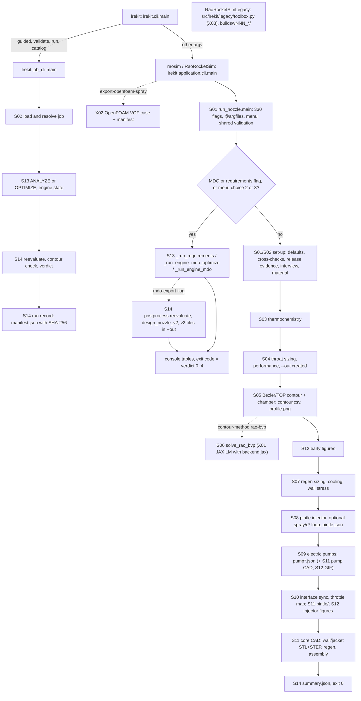

# LREKit CLI data flow: stages S01-S14 and groups X01-X08

This is the map of the repository by **CLI data flow**. It names each stage of the command-line
pipeline in execution order, the modules each stage owns, the function and line where each step
runs, the files each step writes, and where documentation disagrees with the code. It is the
reference for the stage IDs used in [CODE_MAP.md](CODE_MAP.md),
[CODE_HEADER_COMMENTS.md](CODE_HEADER_COMMENTS.md) and the `docs/subsystems/Sxx-<slug>/` folders.
The PDF version is Chapter 2 of the repository guide
([ch02_cli_dataflow.tex](../../latex-report/RaoRocketSim_Repository_Guide/chapters/ch02_cli_dataflow.tex)).

* **Basis.** This page comes from a code-derived trace of the working tree on 2026-11-05. The trace
  combines an AST import closure with a read of the dispatch code, and it was spot-checked line by line
  against [`src/lrekit/application/runner.py`](../../src/lrekit/application/runner.py). That file has 6,981 lines, and `main()`
  spans lines 2817 to 6977. A bare reference such as `:4452` is a line of `src/lrekit/application/runner.py`.
  References into other files name the file. Where a document and the code disagree, the code wins.
* **Maturity.** Every path below produces preliminary, screening-level design output. The runner sets
  `summary["hardware_qualified"] = False` unconditionally (`:4968`) and prints at exit that numerical
  design and CAD output is never hardware-qualified (`:6976`). The job run record writes
  `"hardware_release": False` into its manifest (`src/lrekit/optimization/run_record.py:46`). Nothing here is
  physically validated.

## Contents

1. [Stage table](#1-stage-table)
2. [Entry points](#2-entry-points)
3. [CLI surface](#3-cli-surface)
4. [Dispatch inside the runner](#4-dispatch-inside-the-runner)
5. [Traditional pipeline in execution order](#5-traditional-pipeline-in-execution-order)
6. [Branches: MDO, job path, export verb, legacy](#6-branches-mdo-job-path-export-verb-legacy)
7. [Artifacts written per stage](#7-artifacts-written-per-stage)
8. [Cross-cutting groups](#8-cross-cutting-groups)
9. [Import closure](#9-import-closure)
10. [Where documentation disagrees with the code](#10-where-documentation-disagrees-with-the-code)
11. [How to find things](#11-how-to-find-things)

---

## 1. Stage table

The stages are numbered in the order the default traditional run executes them. S06 replaces the
contour step of S05 when it is selected. S12 figures and some S11 CAD run inside the blocks of the
stages they depend on. S13 and S14 are reached through the early-exit MDO branches and the job path.

| ID | Slug | Name | Modules | Subsystem folder |
|---|---|---|---|---|
| S01 | `cli-entry-and-dispatch` | CLI entry points, argument parsing and workflow dispatch | `src/lrekit/__init__`, `src/lrekit/__main__`, `src/lrekit/cli`, `src/raosim/__init__`, `src/raosim/__main__`, `src/lrekit/application/cli`, `src/lrekit/application/runner`, `scripts/run_nozzle` | none |
| S02 | `inputs-and-contracts` | Inputs, units, validation and job contracts | `src/lrekit/job_cli`, `src/lrekit/guided`, `input_validation`, `units`, `mdo/job`, `mdo/capabilities`, `mdo/metrics`, `manufacturing_limits` | none |
| S03 | `propellant-thermochemistry` | Propellant identity and chamber thermochemistry | `propellants`, `cea`, `frozen_flow` | none |
| S04 | `performance-and-off-design` | Throat sizing, ideal/delivered performance and off-design screens | `engine`, `gas_dynamics`, `separation`, `wall_pressure`, `atmosphere` | [S04-performance-and-off-design](../subsystems/S04-performance-and-off-design/) |
| S05 | `nozzle-and-chamber-geometry` | Default Bezier/TOP nozzle contour, throat and chamber geometry | `nozzle_geometry`, `rao_top_chart`, `throat_geometry`, `chamber_geometry`, `validation` | [S05-nozzle-and-chamber-geometry](../subsystems/S05-nozzle-and-chamber-geometry/) |
| S06 | `rao-moc-bvp-contour` | Opt-in Rao variational / method-of-characteristics BVP contour | `rao_variational`, `rao_residuals`, `moc`, `moc_bounded`, `moc_topology`, `nasa_moc`, `transonic_kernel`, `wall_model`, `rao_optimizer`, `rao_existence_scan` | [S06-rao-moc-bvp-contour](../subsystems/S06-rao-moc-bvp-contour/) |
| S07 | `regen-cooling-and-wall-structures` | Regenerative wall sizing, cooling analysis and wall structural screens | `thermal_design`, `physics`, `thermofluids`, `regen_profile`, `coolants`, `materials` | [S07-regen-cooling-and-wall-structures](../subsystems/S07-regen-cooling-and-wall-structures/) |
| S08 | `injector-and-spray-coupling` | Pintle injector sizing and optional spray/c* fixed point | `injector`, `movable_pintle`, `spray_coupling` | [S08-injector-and-spray-coupling](../subsystems/S08-injector-and-spray-coupling/) |
| S09 | `feed-system-and-electric-pumps` | Feed-pressure ledger to electric pump, motor, inverter and battery sizing | `pumps`, `electric_technology` | [S09-feed-system-and-electric-pumps](../subsystems/S09-feed-system-and-electric-pumps/) |
| S10 | `interface-and-mass-ledger` | Injector/chamber bolted interface and hardware mass ledger | `interface`, `mass_ledger`, `regen_volumes` | [S10-interface-and-mass-ledger](../subsystems/S10-interface-and-mass-ledger/) |
| S11 | `cad-and-geometry-export` | CAD, mesh and geometry deliverables | `export`, `regen_geometry`, `regen_cad`, `injector_export`, `injector_cad`, `injector_coaxial_cad`, `pump_cad`, `pump_cad_brep`, `engine_cad` | none |
| S12 | `plots-and-flow-visualization` | Figures, MOC construction diagrams and flow animations | `plotting`, `flow_viz`, `moc_diagrams`, `injector_plots` | none |
| S13 | `engine-mdo-and-requirements` | Differentiable whole-engine MDO, optimizer and requirement-driven design | `requirements` and `mdo/{__init__, schema, scaling, grid, bounds, material_map, properties, propellants, assembly, cooling, coolant_htd, injector, pintle, pump, mass, structures, envelope, engine, state, constraints, objectives, nlp, convergence, nozzle}` | [S13-engine-mdo-and-requirements](../subsystems/S13-engine-mdo-and-requirements/) |
| S14 | `reevaluation-provenance-and-run-records` | Authoritative re-evaluation, provenance, release gates and run records | `design`, `mdo/{execute, postprocess, snapshot, resolved_inputs, contour_validation, run_record, build}`, `model_registry`, `release_readiness` | none |

Unprefixed module names are under `src/lrekit/`. Placement notes:

* `design.py` is placed in S14. For the current CLI, its orchestrator `design_nozzle_v2` is the authoritative
  re-evaluation after MDO. The traditional runner imports only its spec dataclasses and
  `throat_radius_for_target_thrust` (an S04 step).
* `materials.py` is looked up early (`:4096-4113`), but it is S07's property source. `electric_technology.py`
  is resolved at parse time (`:3792`), but it is S09's drive and battery dataset. `release_readiness.py` is
  loaded at `:4044` and reported at the end, so it sits in S14.

**Related documents outside the subsystem folders** (current locations):

| Stage | Documents |
|---|---|
| S02 | [MDO_REMEDIATION_AND_OUTPUT_CONTRACT.md](MDO_REMEDIATION_AND_OUTPUT_CONTRACT.md), [INPUT_EXECUTION_INTEGRITY_2026-09-09.md](../audits/INPUT_EXECUTION_INTEGRITY_2026-09-09.md), [CONTRACT_INTEGRITY_REMEDIATION_2026-09-05.md](../audits/CONTRACT_INTEGRITY_REMEDIATION_2026-09-05.md), [LREKIT_WORKFLOW_AUDIT_2026-09-04.md](../audits/LREKIT_WORKFLOW_AUDIT_2026-09-04.md) |
| S03 | [CEA_H1_HOST_EVIDENCE_2026-08-22.md](../audits/CEA_H1_HOST_EVIDENCE_2026-08-22.md); frozen variable-cp expansion is in the S04 folder |
| S05 | [chamber_design_literature.md](../literature/chamber_design_literature.md) |
| S06 | [JAX_DIFFERENTIABLE_PLAN.md](../program/JAX_DIFFERENTIABLE_PLAN.md), [RAO_B3_B5_HOST_EVIDENCE_2026-08-24.md](../audits/RAO_B3_B5_HOST_EVIDENCE_2026-08-24.md), [nasa_jhu_file_list.txt](../data/nasa_jhu_file_list.txt) |
| S07 | [thermofluid_literature_provenance.md](../literature/thermofluid_literature_provenance.md) |
| S08 | [pintle_injector_literature_inventory.md](../literature/pintle_injector_literature_inventory.md) |
| S09 | [LREKIT_PUMP_AUDIT_2026-09-05.md](../audits/LREKIT_PUMP_AUDIT_2026-09-05.md), [PUMP_GEOMETRY_IMPLEMENTATION_PLAN_2026-07-13.md](../program/PUMP_GEOMETRY_IMPLEMENTATION_PLAN_2026-07-13.md) |
| S10 | [PLAN_VALVES_LINES_BRACKETS_GIMBAL.md](../program/PLAN_VALVES_LINES_BRACKETS_GIMBAL.md) |
| S11 | Pump CAD: [PUMP_CAD_IMPLEMENTATION_PLAN.md](../subsystems/S09-feed-system-and-electric-pumps/PUMP_CAD_IMPLEMENTATION_PLAN.md) |
| S13 | [IMPLICIT_RAO_JAX_MDO_ARCHITECTURE.md](IMPLICIT_RAO_JAX_MDO_ARCHITECTURE.md), [MDO_ISSUES_AND_WORKFLOW_BLOCKERS_2026-10-16.md](../audits/MDO_ISSUES_AND_WORKFLOW_BLOCKERS_2026-10-16.md), [ROADMAP_REQUIREMENTS_TO_PARTS.md](../program/ROADMAP_REQUIREMENTS_TO_PARTS.md) |
| S14 | [PHYSICAL_RELEASE_GATES.md](PHYSICAL_RELEASE_GATES.md), [MODEL_REGISTRY.md](MODEL_REGISTRY.md) |

---

## 2. Entry points

[`pyproject.toml`](../../pyproject.toml) declares four console scripts and installs the `raosim` and
`lrekit` packages from `src/`. The former top-level `main.py` is now the module `lrekit.legacy.toolbox`.

| Entry | Target | What runs |
|---|---|---|
| `lrekit` | `lrekit.cli:main` ([`src/lrekit/cli.py:18`](../../src/lrekit/cli.py)) | If `argv[1]` is in `JOB_VERBS` = {`guided`, `run`, `validate`, `catalog`} (`src/lrekit/job_cli.py:29`), control passes to `lrekit.job_cli.main` (`job_cli.py:398`). Otherwise control passes to `lrekit.application.cli.main`. |
| `raosim`, `RaoRocketSim` | `lrekit.application.cli:main` ([`src/lrekit/application/cli.py:9`](../../src/lrekit/application/cli.py)) | If `argv[1] == "export-openfoam-spray"` (`src/lrekit/application/cli.py:11`), control passes to `lrekit.simulation.openfoam.case.cli_main` (`openfoam/case.py:1611`). Otherwise `lrekit.application.runner.main` (`:2817`) runs. |
| `RaoRocketSimLegacy` | `lrekit.application.cli:legacy_main` (`src/lrekit/application/cli.py:21`) | `import_module("lrekit.legacy.toolbox").main()`: the legacy toolbox, formerly `main.py` ([`src/lrekit/legacy/toolbox.py`](../../src/lrekit/legacy/toolbox.py), group X03). |
| `python -m lrekit` / `python -m raosim` | `src/lrekit/__main__.py`, `src/raosim/__main__.py` | Same as `lrekit` / `raosim`. |
| `scripts/run_nozzle.py`, `src/lrekit/run.sh` | compatibility wrappers | `lrekit.application.runner.main`. |

* The implementation lives once, under `lrekit`. `raosim.<x>` (the package's name until 2026-11-21) and the former
  flat module names (`raosim.cea`, `raosim.mdo`, `lrekit.engine`, ...) are import aliases installed by
  [`src/lrekit/_compat.py`](../../src/lrekit/_compat.py): each resolves to the same module object as its canonical
  name (`lrekit.thermochemistry.cea`, `lrekit.optimization`, ...), so every dataclass and registry exists once and
  old pickles still load. `src/raosim/` holds only `__init__.py` and `__main__.py`. Before 2026-11-21
  `lrekit/__init__.py` extended `__path__` with `raosim.__path__`, which executed each module a second time;
  `tests/contracts/test_module_identity.py` pins the fix.
* Dispatch is lazy. Eagerly, `lrekit.cli` imports only `src/lrekit/__init__.py`, `src/lrekit/_compat.py`, `src/lrekit/cli.py` and `src/lrekit/application/cli.py`.
  Importing `src/lrekit/application/runner.py` eagerly pulls in 19 modules: `chamber_geometry`, `coolants`, `export`,
  `gas_dynamics`, `materials`, `moc`, `nasa_moc`, `physics`, `rao_residuals`, `rao_variational`,
  `regen_geometry`, `regen_profile`, `separation`, `thermofluids`, `throat_geometry`, `validation`,
  `wall_model`, the `raosim` package and the runner itself. Every other discipline loads on first use.

---

## 3. CLI surface

### 3.1 Job verbs and the OpenFOAM export verb

| Invocation | Handler chain | Writes |
|---|---|---|
| `lrekit guided [--save FILE] [--run]` | `job_cli._cmd_guided` (`:274`) → `lrekit.guided.run_guided` (`guided.py:271`) → `GuidedSession.run` (re-prompting through `units.parse_quantity`) → `_build_spec` → `mdo.job.resolve_engine_job` (`job.py:889`) → coverage preview (`mdo.coolant_htd.htd_availability`); then `_cmd_run` with `--run` | Job YAML or JSON with `--save` |
| `lrekit validate JOB.yaml [--resolved-out FILE]` | `_cmd_validate` (`job_cli.py:181`): `_load_job_document` (rejects duplicate keys) → `_build_spec` (rejects unknown keys) → `mdo.execute.expand_architectures` (`execute.py:814`) → `resolve_engine_job`. Nothing is solved. | Resolved job JSON with `--resolved-out` |
| `lrekit run JOB.yaml [--out FILE]` | `_cmd_run` (`job_cli.py:209`); see [section 6.2](#62-job-path-lrekit-run-and-its-run-record) | Run record; result JSON with `--out`. Exit code = verdict |
| `lrekit catalog TOPIC` | `_cmd_catalog` (`job_cli.py:320`). The 8 topics (`job_cli.py:31-34`) are `variables`, `targets`, `objectives`, `constraints`, `propellants`, `materials`, `unavailable` and `capabilities`, read from `mdo.job.VARIABLE_DIMENSIONS`, `mdo.metrics`, `mdo.constraints.CONSTRAINT_MANIFEST`, `mdo.propellants.PROPELLANTS`, `materials.material_names` and `mdo.capabilities.JOB_CAPABILITIES` | Console only |
| `lrekit export-openfoam-spray OUTPUT [--case-row case_1..case_4] [--wedge-angle-deg] [--opening-cells] [--radial-cells]` | `src/lrekit/application/cli.py:11-13` → `openfoam.case.cli_main` (`case.py:1611`) → `build_radhakrishnan2018_sheet_vof_case` (`:456`) → `write_openfoam_case` (`:1520`). Defaults: `case_1`, 5.0 deg, 6, 240 (`case.py:1622-1627`) | Version-pinned OpenFOAM VOF case + `raosim_openfoam_manifest.json` (`case.py:47`). OpenFOAM is never run. |

### 3.2 The flag runner: 330 flags by family

`run_nozzle.main` builds one flat `argparse.ArgumentParser` with **330 `add_argument` calls** (lines 2819 to
3782) and no argument groups. The grouped list printed by `--tags` (`print_tags`, `:139`) is maintained by hand,
separately from the parser, and shows a subset. The families below are this document's grouping by consuming
stage. The counts come from an AST walk of `main()` and sum to 330.

| Family | n | Representative flags | Consumed by |
|---|---:|---|---|
| Operating point and nozzle | 9 | `--pc --pa-over-p0 --target-thrust --rt --epsilon --length-pct --gamma --contour-method --allow-chart-extrapolation` | S04, S05 |
| Propellant and thermochemistry | 15 | `--propellant --oxidizer --fuel --thermo-mode --mixture-ratio --eta-cstar --eta-cf --nozzle-expansion-model --frozen-gas-table`, per-stream inlet temperature/pressure/phase | S03; inlet states S08 |
| Chamber and throat geometry | 11 | `--l-star --contraction-ratio --shoulder-radius-factor --shoulder-sizing --minimum-cylindrical-length --convergent-angle --ru-factor --rd-factor --cd-target` | S05 |
| Rao BVP solver | 8 | `--backend --max-nfev --n-control --n-kernel --theta-b-guess --kernel-dtheta-limit-deg --kernel-massflow-rel-tol --allow-unconverged` | S06 only |
| Release evidence | 3 | `--release-evidence-manifest --configuration-id --require-release-evidence` | S14 |
| Regen, cooling, thermofluids, wall sizing, structure | 47 | `--regen --channels --channel-* --helix-turns --wall-thickness --wall-sizing --size-wall --auto-size --thermal --material --jacket-material --coolant* --coolant-property-backend --hydraulic-network --radiation-* --boiling-chf --structural-fos --required-cycles --t-hot-* --buckling-*` | S07; regen geometry S11 |
| Fixed pintle injector, feed ports, manifolds, throttle map | 47 | `--injector --injector-architecture --injector-sizing --fuel/oxidizer-injector-dp-fraction --pintle-* --*-discharge-coefficient --*-inlet-* --*-manifold-* --allow-infeasible-injector --throttle-map`, plus the hidden `--injector-pressure-drop` (help suppressed, rejected at `:661`) | S08, S10 |
| Movable (Son) pintle evidence | 54 | `--movable-post-* --movable-center-gap-* --movable-cd-* --movable-position-* --movable-actuator-* --movable-stem-* --movable-sheet-*` | S08 |
| Spray/c* coupling | 7 | `--spray-cstar-coupling --spray-eta-mixing --spray-eta-combustion --spray-coupling-* --spray-evaporation-constant` | S08 |
| Feed-pressure ledger | 23 | `--feed-architecture --*-tank-pressure --*-supply-pressure --*-flow-capacity --*-line-loss[-fraction] --*-manifold-loss[-fraction] --*-control-margin[-fraction] --*-npsh-required --pump-efficiency-*` | S08 feed spec, S09 |
| Electric pump, motor, inverter, battery | 27 | `--electric-pump/--no-electric-pump --electric-technology --pump-rpm --burn-time --motor-* --inverter-* --battery-* --vehicle-mass --pump-head-coefficient --pump-tip-speed-limit --allow-infeasible-pump` | S09 |
| Interface, seals, manufacturing limits | 19 | `--flange-od --flange-length --bolt-* --joint-separation-factor --injector-face-od --injector-face-thickness --seal-type --o-ring-groove-* --min-tool-diameter --injector-tolerance --igniter-port-*` | S08, S10, S11 |
| CAD export | 16 | `--cad --require-brep --regen-brep --regen-manifolds --regen-release-mode --regen-port-* --engine-assembly --injector-cad --injector-cad-format --pintle-sleeve --pump-cad --pump-cad-format --allow-open-pump-mesh` | S11 |
| Visualisation | 5 | `--flowfield --animate --chamber-temp --pump-visualize --show` | S12 |
| Modes and output | 6 | `-i/--interactive --complete-package --tags --list-materials --no-banner --out` | S01 |
| Whole-engine MDO | 23 | `--engine-mdo --engine-mdo-optimize --engine-mdo-couple-cstar --isp-min --isp-sweep --mdo-multistart --mdo-station-study --mdo-propellant --mdo-of-mode --mdo-export --design-margins --film-frac --t-wall --allow-incomplete-physics` | S13, S14 |
| Requirement-driven design | 10 | `--requirements --thrust-condition --isp-basis --flight-duration --qualification-duration --envelope-diameter-max --envelope-length-max --burnout-mass-max --throttle-range --reusable-cycles` | S13 |
| **Total** | **330** | | |

Parser behaviour that matters for every run:

* **Argument files.** `_expand_arg_files` (`:562`, called at `:3785`) expands `@file.args` before parsing.
  Files are read as shell-style tokens with comments, nested includes resolve relative to the including file,
  and later flags override earlier ones. The four shipped files are in [`examples/cli/`](../../examples/cli/).
* **Units.** Runner flags are plain numbers read as SI by convention (Pa, m, N, kg/s). The runner never calls
  `src/lrekit/core/units.py`. Only the job dialect parses unit-bearing strings.
* **Defaults that decide the path.** `--contour-method bezier` (`:2827-2831`), `--out builds/nozzle_run`
  (`:3534`), `--cad none` (`:3535`) and `--require-brep` true (`:3538-3545`). `--backend jax` (`:2953`) only
  matters on the `rao-bvp` path.
* **Inert solver flags.** The eight Rao BVP solver flags act only with `--contour-method rao-bvp`. On the default
  path, `_solve` (`:1464-1487`) calls `nozzle_geometry.bell_nozzle_contour` without them.

---

## 4. Dispatch inside the runner

In order, `run_nozzle.main`:

1. builds the parser (`:2819-3782`), expands argument files (`:3785`) and parses (`:3790`);
2. calls `_reject_legacy_injector_pressure_drop` (`:661`, called at `:3791`);
3. calls `_apply_electric_technology` (`:522`, called at `:3792`), which fills the eight motor, inverter and battery flags;
4. runs the **front door** (`:3797-3811`) on a bare run or with `-i`, unless `--engine-mdo` or `--engine-mdo-optimize` is set.
   `_select_mode_interactively` (`:1850`) prints `_MODE_MENU` (`:1756`). Choice 1 continues on the traditional path
   with the starter defaults. Choice 2 runs `_interactive_engine_mdo` (`:1778`) and then `_run_engine_mdo`. Choice 3
   runs the same interview with `optimise=True` and then `_run_engine_mdo_optimize`. End of input returns 130;
5. calls `_validate_common_engine_args` (`:719`, called at `:3812`), which runs
   `lrekit.core.input_validation.validate_engine_inputs` before every branch;
6. refuses `--mdo-multistart`, `--mdo-multistart-seed` and `--mdo-station-study` unless `--engine-mdo-optimize` is set (`:3813-3829`);
7. branches, first match wins: `--requirements` → `_run_requirements` (`:3830`); `--engine-mdo-optimize` →
   `_run_engine_mdo_optimize` (`:3832`); `--engine-mdo` → `_run_engine_mdo` (`:3834`). Anything else runs the traditional pipeline.

---

## 5. Traditional pipeline in execution order

This path serves `lrekit [flags]`, bare runs that choose menu item 1, and the `@examples/cli/*.args` files.

### S01/S02: defaults, cross-checks, release evidence, interview

* `--complete-package`, or a bare run, calls `_apply_complete_package_defaults` (`:607`, called at `:3836`).
  It sets LOX/RP-1, `--injector pintle`, `--electric-pump` and the starter tank pressures, and records what it
  filled in `args._complete_package_default_notes`.
* `_apply_wall_sizing_mode` (`:920`, called at `:3842`) maps `--wall-sizing` and `--size-wall` onto `args.regen`
  and `args.size_wall`.
* Mutual-exclusion and domain checks run at `:3843-4005`. Frozen variable-cp is Bezier-only and excludes
  regen/thermal; `--regen-brep` needs `--regen` and `--cad`; `--flowfield` and `--animate` need `rao-bvp`; spray
  flags need `--spray-cstar-coupling`. Bounds checks cover gamma, L*, contraction ratio, shoulder and throat
  radii, flange and bolts, and wall and liner thickness.
* `args._cooling_options` is assembled at `:4013-4028`.
* `--tags` (`:139`) and `--list-materials` (`:4038-4042`) print and exit 0.
* **Release evidence** (`:4044-4062`). `release_readiness.load_evidence_manifest` runs with
  `--release-evidence-manifest`; otherwise `evaluate_release_readiness(target="engine")` runs. The result is stored
  as `args._release_readiness`. `--require-release-evidence` turns an incomplete report into a parser error.
* The interview `_interactive` (`:957`, called at `:4073`) runs on bare or `-i` runs, then the wall-sizing mode and
  the validation are re-applied. `_ensure_pyplot` (`:324`, called at `:4077`) imports Matplotlib lazily (Agg
  unless windows are requested).
* The coolant inlet temperature defaults by fluid (`:4079-4090`). `materials.get_material(--material)` sets the
  wall conductivity and temperature limit (`:4096-4113`). `--size-wall` without `--material` returns 2.

### S03: propellant and thermochemistry

* The oxidizer and fuel identities are split at `:4138-4147`. With `--regen`, `--spray-cstar-coupling` is refused
  unless the coolant is the cycle fuel (`:4148-4157`). `--mixture-ratio` defaults to the table's nominal O/F
  (`:4165-4182`).
* `cea.resolve_thermochemistry` (`cea.py:211`, called at `:4202`) returns the `Propellant` record. Constant-gamma
  mode uses the built-in table; `--thermo-mode cea` uses a RocketCEA frozen chamber snapshot.
  `propellants.custom_propellant` builds a placeholder gas when no propellant is named (`:4184-4199`) and is used
  again for efficiency or gamma overrides (`:4213-4245`).
* `--nozzle-expansion-model frozen-variable-cp` calls `frozen_flow.load_frozen_gas_table` (`:4257`).
  `--cd-target` sets `args.ru_factor` through `throat_geometry.upstream_radius_ratio_for_discharge_coefficient` (`:4292`).

### S04: throat sizing and performance

* `--target-thrust` calls `design.throat_radius_for_target_thrust` (`design.py:1222`, called at `:4311`).
  `engine.compute_engine_performance` (`engine.py:69`, called at `:4319`) returns Cf, c*, Isp, mass flow, exit Mach
  and exit pressure. The mass flow is split by O/F at `:4330-4333`.
* `_apply_split_injector_pressure_model` (`:680`, called at `:4339`) sets the injector pressure drops as fractions
  of Pc and, when the coolant is the cycle fuel, the jacket outlet boundary. `_validate_pump_args` follows at `:4340`.
* `args.out.mkdir` (`:4342`). The output directory exists only from this point.

### S05/S06: contour and chamber

* `_solve` (`:1464`, called at `:4452`). With the default `bezier`, it calls `nozzle_geometry.bell_nozzle_contour`
  with SP-125 Figure 4-14 chart angles from `rao_top_chart.py` and wraps the result in `_TrustedTopSolution` (`:1403`).
  With `rao-bvp`, it builds a `RaoSolverConfig` (`wall_method="bde"`) and calls `rao_variational.solve_rao_bvp`
  (`rao_variational.py:5901`). `--backend jax` uses `jax.api.least_squares_jax` (called at
  `rao_variational.py:6069`) and `jax.theta_b_solve.least_squares_jax_theta_b` (`rao_variational.py:6029`).
* The reliability gates run at `:4456-4840` (2e-3 residual, mass and length closure, MOC compatibility, valid region,
  thrust sanity). An export-gate failure returns 2 with no artifacts (`:4834`). The overrides are
  `--allow-unconverged` (rao-bvp) and `--allow-chart-extrapolation` (Bezier) at `:4817-4820`.
* Chamber (`:4841-4896`): `auto_shoulder_factor` (`:4861`), `chamber_contour` (`:4868`), `full_engine_contour`
  (`:4876`), `failed_thrust_chamber_geometry_checks` (`:4880`). A failed check returns 2 with no artifacts.
* `summary` is assembled at `:4899-5040`, including `model_registry.audit_model_registry` (`:4967-4974`).
  The run writes `contour.csv` and `profile.png` (`:5042-5052`), and `contour_moc_crossings.csv` when crossings were
  sampled (`:5053-5062`).

> **Working-tree regression (2026-11-05).** The modified `src/lrekit/components/nozzle/geometry.py` and the new, untracked
> `src/lrekit/components/nozzle/top_chart.py` add a strict chart-domain gate. `lookup_angles` (`nozzle_geometry.py:47`, raise at `:67`)
> raises `ValueError` outside epsilon in [5, 50] or length in [60, 100] %. `_solve` passes no explicit angles, so the
> error escapes `main` as a traceback, before the `--allow-chart-extrapolation` override at `:4817-4820` is reached.
> On 2026-11-05, [`test_13kn_sealevel_regen_allstl.args`](../../examples/cli/test_13kn_sealevel_regen_allstl.args)
> (epsilon 4.524, default Bezier) failed this way at `run_nozzle.py:4452`.
> [`test_13kn_movable_pintle.args`](../../examples/cli/test_13kn_movable_pintle.args) uses the same epsilon on the
> same path. The `rao-bvp` example ran to exit 0.

### S12: early figures (best effort; exceptions become skips)

* `plotting.plot_separation_on_contour` (`:5074`) writes `separation_contour.png`.
* On `rao-bvp` runs with BDE artifacts, `moc_diagrams` writes `kernel_fan.png`, `rao_topology.png`, `bde_mesh.png`,
  `bde_diagnostics.png` and `bde_integrity.png` (`:5091-5122`).
* `--flowfield` → `flow_viz.plot_flowfield` (`:5130`) → `flowfield.png`. `--animate` → `animate_moc_march` /
  `animate_particles` (`:5156`, `:5167`) → `anim_moc_march.gif`, `anim_particles.gif`.

### S07: regen wall sizing, cooling, wall structure

* `--regen --size-wall` (`:5177-5359`). `thermal_design.joint_wall_channel_design` (`:5191`) sizes the hot wall
  and channels under thermal, SP-125 eq. 4-31 stress, fatigue and pressure-drop limits. `size_wall_profile` (`:5302`)
  then produces the station-wise `RegenWallProfile` stored as `args._wall_profile`. This fills `summary["wall_sizing"]`
  and `summary["wall_profile"]`.
* `--regen --auto-size` → `thermal_design.size_cooling_channels` (`:5367`) → `summary["channel_sizing"]`.
* `--regen --thermal` (`:5409-5616`) → `physics.bartz_heat_flux`, then `physics.regenerative_cooling_analysis`
  (`:5439`), a Sieder-Tate coolant march with `thermofluids.py` options. Results go to `summary["cooling"]`, plus
  `cooling_profile.png`, `channel_march.png` and `cross_section.png`. With catalog elastic data,
  `physics.coaxial_shell_wall_stress_profile` (`:5572`) fills `summary["structural"]` and `structural_life.png`.

### S08: pintle injector and optional spray/c* fixed point

* The injector runs after cooling, so its fuel feed state is the regen outlet state. The `InjectorSpec` is built at
  `:5701-5849` (`_feed_system_spec_from_args`, `:852`).
* Default: the closure `evaluate_cli_injector` (`:5903`) calls `injector.evaluate_pintle_injector`
  (`injector.py:3457`, call at `:5912`). It is invoked at `:6182`. `movable_pintle.py` handles
  `son_continuous_movable`.
* `--spray-cstar-coupling` → `spray_coupling.solve_spray_cstar_fixed_point` (`spray_coupling.py:210`, called at
  `:5989`). This re-runs `compute_engine_performance` (`:5998`) and rewrites the cooling, structural and figure
  artifacts from the final iterate. The runner builds `SprayCStarCouplingSpec` without `source` (`:5934-5941`), so
  the default `"legacy_screen"` (`spray_coupling.py:32`) applies. The Lagrangian parcel solver in `src/lrekit/components/injector/spray/` is
  never executed from the CLI.
* A rejected injector writes `summary.json` and returns 2 (`:6188-6193`). Otherwise the run writes `pintle.json` (`:6204`).

### S09: electric pump feed (only with `--electric-pump`)

* `pumps.size_electric_pumps(inj.feed_system, _pump_spec_from_args(args))` (`pumps.py:3747`, called at `:6212`)
  writes `pump.json`, `pump_bom.json` and `pump_reference_geometry.json` (`:6219-6238`).
* S11 pump CAD runs inside this block: `pump_cad.export_pump_package` (`:6250`), plus
  `pump_cad_brep.export_pump_brep_package` (`:6267`) for `--pump-cad-format step|both`. S12 `animate_pump_particles`
  (`:6340`) runs with `--pump-visualize`.
* Failed pump gates (`:6352-6357`) and failed injector gates (`:6361-6365`) write `summary.json` and return 2 unless
  `--allow-infeasible-pump` / `--allow-infeasible-injector` is given. A failed requested pump CAD package also returns 2 (`:6313-6326`).

### S10/S11: interface sync, throttle map, injector package

* `injector_cad.resolve_machined_pintle_layout` (`:6373`) and `interface.resolve_bolted_interface_geometry`
  (`:6375`) auto-size the flange, face and bolt pattern and write the values back (`:6369-6432`).
* `--throttle-map` → `injector.throttle_map` (`injector.py:2565`, called at `:6442`). An unreachable map returns 2 (`:6500-6511`).
* `injector_export.export_pintle_package` (`:6525`) writes `pintle/`. A failure with `--injector-cad` other than
  `none` returns 2 (`:6543-6557`). `injector_plots.export_all_injector_figures` (`:6563`) writes `injector_*.png`.
* The interface screen (`:6574-6655`) runs `interface.screen_composite_regen_wall` (`:6592`) and
  `interface.screen_injector_chamber_interface` (`:6611`).

### S11: core CAD

* `export.export_stl` (`:6689`) writes `wall.stl`; `export.inspect_stl` (`:6695`) checks that it is watertight. A
  sized profile adds `jacket.stl` (`:6728-6733`).
* `--cad step|ipt|both` → `export.export_step` (`:6747`, `:6785`) → `wall.step` (and `jacket.step`); a true B-rep
  is required unless `--no-require-brep` is given. `--regen-brep` / `--regen-manifolds` →
  `regen_cad.export_channel_wall_step` (`:6820`) → `regen.step`. `--cad ipt|both` →
  `export.package_ipt_request` (`:6863`) → `wall_ipt_manifest.json`.
* `--regen` → `regen_geometry.generate_regen_nozzle` (`:6888`) → `regen.stl`, `regen_3d.png`. `--engine-assembly`
  → `engine_cad.export_engine_assembly` (`:6938`) → `engine_assembly.step`. A failed assembly gate is re-raised as
  `RuntimeError` (`:6951-6955`).

### S14: final write

`summary.json` is always written (`:6957`). The release report selects the "Physical release BLOCKED" message
(`:6965-6970`) or the "evidence complete" message, and the run returns 0 (`:6977`).

---

## 6. Branches: MDO, job path, export verb, legacy

### 6.1 Early-exit MDO branches (S13 → S14)

Shared helpers: `_mission_from_mdo_args` (`:1998`) → `mdo.schema.MissionSpec`; `_resolve_mdo_of_intent` (`:1913`);
`_mdo_contour_request_error` (`:1866`) allows `rao-bvp` only with `--mdo-export` and `--cad none`. JAX is imported
lazily with x64 enabled (`:2096`, `:2516`).

* **`--engine-mdo` → `_run_engine_mdo` (`:2077`).** This branch runs `mdo.engine.chamber_surfaces_for` and
  `mdo.coolant_htd.require_htd_coverage` first; missing coverage returns `INDETERMINATE` (`:2130`). Then
  `mdo.engine.solve_engine` (`mdo/engine.py:282`, called at `:2174`) performs one coupled differentiable evaluation of
  the grid, properties, propellants, cooling, injector, pintle, pump, mass, structures, envelope and assembly blocks.
  `--mdo-export` → `mdo.postprocess.reevaluate` (`postprocess.py:971`, called at `:2301`) → `design.design_nozzle_v2`
  (`design.py:565`) → `design._write_v2_artifacts` (`design.py:2589`).
* **`--engine-mdo-optimize` → `_run_engine_mdo_optimize` (`:2498`).** `--isp-sweep` → `mdo.nlp.pareto_frontier`
  (`:2630`), with each converged point re-evaluated into `--out/pareto_NNN/` (`:2662-2705`). Otherwise
  `mdo.nlp.solve_min_mass` (`:2723`) runs SLSQP with exact JAX Jacobians. `--mdo-station-study` →
  `mdo.convergence.station_refinement_study` (`:2592`). `--mdo-export` → `reevaluate` into `--out` (`:2756`).
* **`--requirements` → `_run_requirements` (`:2360`).** This branch builds `requirements.EngineRequirement`
  (`_parse_thrust_condition`, `:2345`) and calls `requirements.solve_requirement` (`:2427`), which calls
  `mdo.nlp.solve_min_mass`. Output is console only.

Exit codes (`WorkflowExitCode`, `src/lrekit/core/input_validation.py:28-35`; `_run_requirements` returns the same integers,
`:2420-2476`): 0 `MET`, 1 `CANDIDATE_VIOLATES`, 2 `INVALID_INPUT`, 3 `INDETERMINATE` (coverage missing), 4 `SOLVER_FAILED`.

`--mdo-export` writes into `--out`: `thrust_chamber_profile.csv`, `thrust_chamber_wall.step`/`.stl` with its
`.cad.json` sidecar, `design_report_v2.json`, `pintle/` and `engine_analysis_snapshot_v1.json`
(`postprocess._snapshot_report_path`, `postprocess.py:596`).

### 6.2 Job path (`lrekit run`) and its run record

1. `_cmd_run` (`job_cli.py:209`) → `mdo.execute.expand_architectures` (`execute.py:814`). More than one candidate goes to
   `execute_engine_job_set` (`:856`); one candidate goes to `execute_engine_job` (`:333`).
2. `RunRecord.start` (`run_record.py:33`) creates `<output_policy.output_dir>/<uuid4hex>/` with `manifest.json`
   (`in_progress`, `hardware_release: false`) and `job.json`.
3. `_execute_resolved_engine_job` (`execute.py:463`). ANALYZE uses the job design vector; OPTIMIZE uses
   `mdo.nlp.solve_min_mass` (`:559`). Then `mdo.state.solve_engine_state` (`:598`),
   `mdo.resolved_inputs.resolve_engine_inputs` (`:607`) and `mdo.postprocess.reevaluate` (`:640`) →
   `design_nozzle_v2`, with CAD written only into `parts/` when `output_policy.parts == "reference_cad"`. An optional
   post-solve Rao contour validation follows (`mdo.contour_validation` with `rao_existence_scan.RaoConvergenceDomain`,
   `:499-505`), then the statuses and the verdict (`_verdict`, `:248`).
4. `_attach_part_manifest` (`:401`) → `mdo.build.build_engine_parts` / `write_engine_build` →
   `parts/engine_build_manifest.json`.
5. `RunRecord.finish` (`run_record.py:72`) writes each requested report atomically (temporary file, then rename) and
   records its SHA-256 in `manifest.json`. It also hashes the parts manifest and any CAD file that no part claims.
6. `--out FILE` writes the result JSON; the exit code is the verdict.

**Code over trace.** The candidate reports are `summary`, `resolved_inputs`, `snapshot`, `comparison` and
`coverage`, but only the requested ones are written. `start` requests `summary` plus `output_policy.reports`
(`run_record.py:40`), and `OutputPolicy` defaults to `reports=()`, `output_dir=None` and `parts="none"`
(`src/lrekit/optimization/job.py:607-615`). Without an `output_dir` there is no run record at all (`run_record.py:35-36`). A report
that is requested but not produced is written as an `unavailable` stub, and the package is then marked `partial`; unless the job sets `allow_partial_package`, `RunRecord.finish` then raises `RuntimeError` (`run_record.py:145-146`), which `execute_engine_job` converts into a `SOLVER_FAILED` result.

### 6.3 Export verb and legacy toolbox

* `export-openfoam-spray` writes a case only; see [section 3.1](#31-job-verbs-and-the-openfoam-export-verb).
* `RaoRocketSimLegacy` → `main.main` (`src/lrekit/legacy/toolbox.py:1265`): `--benchmark-case` → `run_benchmark_cli`, `--sweep` →
  `run_sweep`, batch → `run_batch` (→ `run_batch_v2` when any v2 field is set, `_should_use_v2` `src/lrekit/legacy/toolbox.py:366`),
  otherwise `run_interactive`. Every legacy path calls `build_log.create_build_dir` (`src/lrekit/legacy/toolbox.py:407`, `:741`, `:929`,
  `:1152`) and writes `builds/vNNN_YYYYMMDD_HHMMSS/metadata.txt`. The test suite drives this path. The 2026-11-05 test
  run created `builds/v455_20261105_070346` to `builds/v461_20261105_071738`, each holding one `cli_*.csv` and a
  `metadata.txt` with `Mode: batch`. All earlier builds are archived under `builds/_archive_2026-11-05/` (index:
  `BUILDS_ARCHIVE_INDEX.md`; `builds/` is gitignored).

---

## 7. Artifacts written per stage

Paths are relative to `--out` (traditional runner and MDO export), to the run-record directory (job path), or as
stated.

| Stage | Function (call site) | Artifact files | Condition |
|---|---|---|---|
| S04 | `args.out.mkdir` (`:4342`) | output directory (default `builds/nozzle_run`) | always (after throat sizing) |
| S02 | `job_cli._cmd_guided`, `_cmd_validate` | job YAML/JSON; resolved job JSON | `--save`; `--resolved-out` |
| S05 | `np.savetxt`, Matplotlib (`:5042-5052`) | `contour.csv`, `profile.png` | contour and chamber gates pass |
| S06 | `_write_moc_crossing_samples` (`:427`; `:5053-5062`) | `contour_moc_crossings.csv` | crossings sampled |
| S12 | `plotting.plot_separation_on_contour` (`:5074`) | `separation_contour.png` | best effort |
| S12 | `moc_diagrams.*` (`:5091-5122`) | `kernel_fan.png`, `rao_topology.png`, `bde_mesh.png`, `bde_diagnostics.png`, `bde_integrity.png` | `rao-bvp` only |
| S12 | `flow_viz.plot_flowfield` (`:5130`); `animate_moc_march`, `animate_particles` (`:5156`, `:5167`) | `flowfield.png`; `anim_moc_march.gif`, `anim_particles.gif` | `--flowfield`; `--animate` (rao-bvp) |
| S07/S12 | `plotting.plot_cooling_profile`, `plot_coolant_channel_march`, `plot_channel_cross_section`, `plot_structural_life_dashboard` (`:5499-5616`; rewritten `:6091-6151` after the spray loop) | `cooling_profile.png`, `channel_march.png`, `cross_section.png`, `structural_life.png` | `--regen --thermal`; structural figure needs catalog elastic data |
| S08 | `inj.to_dict()` (`:6204`) | `pintle.json` | injector evaluated |
| S09 | `pumps.size_electric_pumps` (`:6212`) | `pump.json`, `pump_bom.json`, `pump_reference_geometry.json` | `--electric-pump` |
| S11 | `pump_cad.export_pump_package` (`:6250`); `pump_cad_brep.export_pump_brep_package` (`:6267`) | `pump/` (`pump_parameters.json`, `pump_dimensions.csv`, `pump_reference_assembly.stl`, `pump_reference_assembly_layout.json`); `pump/pump_brep/*.step`, `pump_cad_units.json` | pump CAD; STEP with `--pump-cad-format step\|both` |
| S12 | `flow_viz.animate_pump_particles` (`:6340`) | `pump_particles.gif` | `--pump-visualize` |
| S11 | `injector_export.export_pintle_package` (`:6525`) | `pintle/` (`pintle_parameters.json`, `pintle_dimensions.csv`, `pintle_schematic.svg`, `pintle_cross_section.png`; STEP bodies + `injector_manufacturing_report.json` with CAD) | injector present |
| S12 | `injector_plots.export_all_injector_figures` (`:6563`) | `injector_*.png` | injector present |
| S11 | `export.export_stl` (`:6689`, `:6732`) | `wall.stl`; `jacket.stl` | always; sized profile |
| S11 | `export.export_step` (`:6747`, `:6785`) | `wall.step`; `jacket.step` | `--cad step\|ipt\|both` |
| S11 | `regen_cad.export_channel_wall_step` (`:6820`) | `regen.step` | `--regen-brep` or `--regen-manifolds` |
| S11 | `export.package_ipt_request` (`:6863`) | `wall_ipt_manifest.json` | `--cad ipt\|both` |
| S11 | `regen_geometry.generate_regen_nozzle` (`:6888`) | `regen.stl`, `regen_3d.png` | `--regen` |
| S11 | `engine_cad.export_engine_assembly` (`:6938`) | `engine_assembly.step` | `--engine-assembly` |
| S14 | `summary` dump (`:6957`) | `summary.json` | always on exit 0; also written just before the exit-2 returns at `:6192`, `:6323`, `:6356`, `:6364`, `:6507`, `:6554` |
| S14 | `mdo.postprocess.reevaluate` → `design._write_v2_artifacts` | `thrust_chamber_profile.csv`, `thrust_chamber_wall.step/.stl`, `.cad.json`, `design_report_v2.json`, `pintle/`, `engine_analysis_snapshot_v1.json` | MDO with `--mdo-export`; `pareto_NNN/` per sweep point |
| S14 | `RunRecord.start/finish`; `mdo.build.write_engine_build` | `<uuid4hex>/manifest.json`, `job.json`, `summary.json`, requested reports; `parts/engine_build_manifest.json` | `lrekit run` with `output_dir`; parts with `reference_cad` |
| X02 | `openfoam.case.write_openfoam_case` | OpenFOAM case tree, `raosim_openfoam_manifest.json` | `export-openfoam-spray` |
| X03 | `build_log.create_build_dir`, `write_metadata` | `builds/vNNN_YYYYMMDD_HHMMSS/metadata.txt` + CSV/STL/JSON | `RaoRocketSimLegacy` only |

The runner never imports `lrekit.legacy.build_log`, so versioned `builds/vNNN_*` folders come only from the legacy toolbox.

---

## 8. Cross-cutting groups

These groups sit beside the pipeline. They are not steps in it.

| ID | Slug | Name | Modules | Relation to the CLI | Docs |
|---|---|---|---|---|---|
| X01 | `differentiable-jax-core` | Differentiable JAX core | `src/lrekit/numerics/jax/{__init__, api, assembly, moc_kernel, primitives, sensitivities, thermal, theta_b_solve}` | LM solve for S06 with `--backend jax`; primitives and thermal for S13 | [IMPLICIT_RAO_JAX_MDO_ARCHITECTURE.md](IMPLICIT_RAO_JAX_MDO_ARCHITECTURE.md), [JAX_DIFFERENTIABLE_PLAN.md](../program/JAX_DIFFERENTIABLE_PLAN.md) |
| X02 | `spray-parcel-and-openfoam-handoff` | Opt-in Lagrangian spray and OpenFOAM VOF case export | `src/lrekit/components/injector/spray/*` (14), `src/lrekit/simulation/openfoam/*` (3) | The `export-openfoam-spray` verb. S08 imports spray handoff types only; the parcel solver is API-only | [LAGRANGIAN_SPRAY_MODEL.md](../subsystems/S08-injector-and-spray-coupling/LAGRANGIAN_SPRAY_MODEL.md), [OPENFOAM_SPRAY_EXPORT.md](../subsystems/S08-injector-and-spray-coupling/OPENFOAM_SPRAY_EXPORT.md) |
| X03 | `legacy-toolbox-cli` | Legacy toolbox CLI | `src/lrekit/legacy/toolbox.py`, `build_log`, `trade_study`, `altitude_performance`, `nozzle_comparison`, `conical`, `benchmarks` | `RaoRocketSimLegacy` only; writes `builds/vNNN_*` | [legacy_code_audit.md](../audits/legacy_code_audit.md) |
| X04 | `nasa-jhu-reference-port` | Vendored NASA/JHU MOC_Grid_BDE reference and comparison tooling | `src/lrekit/verification/reference_io.py`, `tests/experiments/nozzle/compare_nasa_reference.py`, `tests/experiments/nozzle/nasa_wall_probe.py`, `Three-Dimensional-Nozzle-Design-Code-master/` | Test oracle for S06; `legacy_io` is imported by `plotting.py` | [rice_jhu_moc_topology_map.md](../subsystems/S06-rao-moc-bvp-contour/rice_jhu_moc_topology_map.md), [nasa_jhu_file_list.txt](../data/nasa_jhu_file_list.txt) |
| X05 | `research-and-offline-scripts` | Standalone research diagnostics and offline generators | 15 `scripts/*.py` (J4/J5 gates, theta_B probes, CEA surface sampler, TVC study, contour/regen generators) | Standalone; not imported by the CLI | [CODE_MAP.md](CODE_MAP.md) |
| X06 | `knowledge-and-source-data` | Knowledge graph, source corpus and packaged data | `src/lrekit/data/tools/{acquire_sources, verify_collection}`, plus `knowledge/`, `src/lrekit/data/`, `propulsion_texts/` | Non-CLI | [knowledge/README.md](../../knowledge/README.md), [src/lrekit/data/README.md](../../src/lrekit/data/README.md) |
| X07 | `test-harness` | Test harness and regression argument files | `tests/`, `knowledge/tests/`, `pytest.ini`, `examples/cli/*.args` | Drives legacy `src/lrekit/legacy/toolbox.py` (creates `builds/vNNN_*`) and the runner | [examples/cli/](../../examples/cli/) |
| X08 | `cli-unreachable-library-code` | Library code not reachable from the CLI | `flange_cad`, `thermal_correlations`, `trajectory`, `jax/{bvp, design_opt, pack, residuals, reference}` | Imported only by tests, or by nothing | [CODE_MAP.md](CODE_MAP.md) |

---

## 9. Import closure

An AST closure over the 161 in-scope modules (`src/lrekit/**` including `jax`, `mdo`, `spray`, `openfoam` and
`data/tools`; `src/lrekit/*`; `src/lrekit/legacy/toolbox.py`; `scripts/*`). It follows function-level imports, relative imports,
`import_module` string literals, parent-package implication and the `lrekit.__path__` alias. It reads files only.

| Category | Count | Modules |
|---|---:|---|
| Reachable from `lrekit.cli` (excluding the legacy `src/lrekit/legacy/toolbox.py` edge) | **125** | All S01 to S14 modules; `src/lrekit/numerics/jax` 8 of 13 (`__init__`, `api`, `assembly`, `moc_kernel`, `sensitivities` and `theta_b_solve` via `rao_variational`; `primitives` and `thermal` via `mdo`); `src/lrekit/optimization` all 34; `src/lrekit/components/injector/spray` all 14 (via `design.py` → `spray_coupling.py` → `spray.handoff`, types only); `src/lrekit/simulation/openfoam` all 3 (export verb); `src/lrekit/verification/reference_io.py` (via `plotting.py`) |
| Reachable only via `RaoRocketSimLegacy` | **7** | `src/lrekit/legacy/toolbox.py`, `altitude_performance`, `benchmarks`, `build_log`, `conical`, `nozzle_comparison`, `trade_study` |
| Not reachable from any CLI (excluding `scripts/`) | **11** | `src/raosim/__main__.py` (entry wrapper); `src/lrekit/data/tools/acquire_sources.py`, `verify_collection.py` (standalone tools); `flange_cad` (only `tests/assembly/test_flange_cad.py`); `trajectory` (only `tests/mission/test_trajectory.py`); `jax/bvp` (`tests/numerics/test_jax_bvp.py`); `jax/design_opt` (`tests/numerics/test_jax_thermal_design_opt.py`); `jax/pack` (`tests/numerics/test_jax_bvp.py`); `jax/residuals` (tests only); `thermal_correlations` (no Python importer); `jax/reference` (no importer) |
| Standalone scripts | **18** | All `scripts/*.py`: the compat wrapper `scripts/run_nozzle.py`, 2 NASA/JHU comparison scripts (X04), 15 research scripts (X05) |
| **Total** | **161** | |

---

## 10. Where documentation disagrees with the code

Each row was re-checked against the working tree on 2026-11-05. In every row the code is authoritative.

| # | Document, location | Document says | Code does | Status |
|---|---|---|---|---|
| 1 | [README.md](../../README.md):1217 (Outputs) | "Normal CLI runs create `builds/vNNN_YYYYMMDD_HHMMSS/`" with design-gate JSON and `metadata.txt` | The runner writes to `--out` (default `builds/nozzle_run`, `:3534`), never imports `build_log`, and reports in `summary.json`. Versioned folders come only from legacy `src/lrekit/legacy/toolbox.py` (`:407/741/929/1152`); `design_report_v2.json` comes only from `design._write_v2_artifacts` | open |
| 2 | README.md:959-1149 (Command-line usage) | Documents the flag runner and legacy alias only | The section omits the job verbs (`job_cli.py:29`), `export-openfoam-spray` (`src/lrekit/application/cli.py:11`), and `--requirements`/`--engine-mdo`/`--engine-mdo-optimize`/`--mdo-export`, all dispatched before the traditional path (`:3830-3835`). The layout block (README.md:1328) names the job verbs in one line | open |
| 3 | README.md:972-973 | "Bare `lrekit` runs enter the same complete-package interactive interview by default" | A bare run prints `_MODE_MENU` first (`:1756`, `:3797-3811`); only choice 1 enters that interview | open |
| 4 | README.md:1314-1356 (Repository layout) | Before the 2026-11-05 edit: `src/lrekit/legacy/toolbox.py` was the "Primary interactive/batch CLI"; `src/lrekit/`, `mdo/` and others were missing; `trajectory.py` was listed as active | The working-tree README lists `src/lrekit/legacy/toolbox.py` as the legacy CLI and links this page; README.md:826 says the trajectory module is not wired into the CLI | fixed |
| 5 | `src/lrekit/cli.py:3`; `src/lrekit/job_cli.py:7-13` | Job verbs "run/validate/catalog"; the catalog lists six topics | `JOB_VERBS` also has `guided` (`job_cli.py:29`); `_CATALOG_TOPICS` has eight (adds `unavailable`, `capabilities`, `:31-34`) | open |
| 6 | [MDO_REMEDIATION_AND_OUTPUT_CONTRACT.md](MDO_REMEDIATION_AND_OUTPUT_CONTRACT.md):151, :157 | `job_cli.py` "adds three verbs"; the catalog list ends at `unavailable` | Four verbs; eight catalog topics including `capabilities` | open |
| 7 | [LREKIT_HARDWARE_PROGRAM_2026-09-05.md](../program/LREKIT_HARDWARE_PROGRAM_2026-09-05.md):620-630 | The proposed verb family "stands": `job`, `component`, `build`, `test`, `calibrate`, `ui`, `catalog models/components/processes/coefficients` | None of these exist; the implemented set is the four job verbs and eight topics | plan only |
| 8 | `src/lrekit/legacy/toolbox.py:6-11` docstring, `src/lrekit/legacy/toolbox.py:95-99` epilog | `lrekit --Rt 25 --Pc 60`, `lrekit --sweep` | `lrekit` now runs the SI runner (`--rt`, `--pc`, no `--sweep`); these flags work only under `RaoRocketSimLegacy` | open |
| 9 | `src/lrekit/application/runner.py:20-55` docstring; [lox_rp1_13kn_copper_316l_full_engine.args](../../examples/cli/lox_rp1_13kn_copper_316l_full_engine.args):27-30, [test_13kn_sealevel_regen_allstl.args](../../examples/cli/test_13kn_sealevel_regen_allstl.args):56-58, [test_13kn_movable_pintle.args](../../examples/cli/test_13kn_movable_pintle.args):34-35 | `--backend jax --regen` and `--max-nfev 0` "seed" examples; argument files set `--max-nfev`, `--n-control`, `--n-kernel` as if a solve runs; the docstring implies `summary.json` needs `--regen` | None of these select `--contour-method rao-bvp`, so the contour is the default Bezier/TOP chart (`:2827-2831`) and `_solve` ignores the solver flags (`:1464-1487`). Only [test_13kn_rao_bvp_flowfield.args](../../examples/cli/test_13kn_rao_bvp_flowfield.args) runs the BVP. `summary.json` is always written (`:6957`) | open |
| 10 | `--allow-chart-extrapolation` help (`run_nozzle.py:2832-2836`) | Writes diagnostic Bezier artifacts outside the chart domain | The working-tree `lookup_angles` raises `ValueError` outside the domain (`nozzle_geometry.py:47`, `:67`) before the override at `:4817-4820`; `test_13kn_sealevel_regen_allstl.args` (epsilon 4.524) was observed failing; `test_13kn_movable_pintle.args` uses the same epsilon on the same path and is expected to fail (not executed) | open (working tree) |
| 11 | [FEATURE_DATAFLOW_AUDIT_2026-07-11.md](../audits/FEATURE_DATAFLOW_AUDIT_2026-07-11.md):20-70 | The packaged CLI runs `design._build_v2_contour`, `physics.boundary_layer_displacement`, `validation.evaluate_design_gates` and `build_log`; legacy adds a trajectory integrator; spray/c* is blocked with CLI regen; the runner has 4,558 lines | `run_nozzle.main` calls none of the four (they are in `design_nozzle_v2`); `src/lrekit/legacy/toolbox.py` does not import `trajectory`; spray with regen is allowed when the coolant is the cycle fuel (`:4148-4157`); the runner has 6,981 lines | historical record |
| 12 | `src/lrekit/numerics/jax/__init__.py:7`; `src/lrekit/numerics/jax/bvp.py:2-4` | JAX "is the default for `solve_rao_bvp`"; `jax/bvp.py` replaces SciPy `least_squares` | True for `--backend`, but the default CLI contour never calls `solve_rao_bvp`. The live solve is `jax/api.least_squares_jax` (`rao_variational.py:6069`); `jax/bvp.py` is imported only by `tests/numerics/test_jax_bvp.py` | open |
| 13 | `src/lrekit/assembly/flange.py:3` ("The gap this closes"); `src/lrekit/components/cooling/correlations.py:1-5` | `flange_cad` presents itself as filling the missing chamber-side flange of the bolted joint; `thermal_correlations` presents itself as source-scoped correlation choices and applicability reports (Bartz bounds) | Neither is imported by any CLI path. The live flange comes from `export.export_step` and `interface.resolve_bolted_interface_geometry`, and `physics.bartz_heat_flux` does not consult `thermal_correlations` | open |
| 14 | [OPENFOAM_SPRAY_EXPORT.md](../subsystems/S08-injector-and-spray-coupling/OPENFOAM_SPRAY_EXPORT.md):88 | `lrekit export-openfoam-spray ... --case-row case_1` | Matches `src/lrekit/application/cli.py:11` and `case.py:1611-1627` | consistent |

---

## 11. How to find things

* **Every code file, its stage and a one-line role:** [CODE_MAP.md](CODE_MAP.md), ordered S01 to S14, then X01 to X08.
* **Verbatim module docstrings and leading comments, by stage:** [CODE_HEADER_COMMENTS.md](CODE_HEADER_COMMENTS.md).
* **Physics and design basis per stage:** the subsystem folders
  [S04](../subsystems/S04-performance-and-off-design/), [S05](../subsystems/S05-nozzle-and-chamber-geometry/),
  [S06](../subsystems/S06-rao-moc-bvp-contour/), [S07](../subsystems/S07-regen-cooling-and-wall-structures/),
  [S08](../subsystems/S08-injector-and-spray-coupling/), [S09](../subsystems/S09-feed-system-and-electric-pumps/),
  [S10](../subsystems/S10-interface-and-mass-ledger/) and [S13](../subsystems/S13-engine-mdo-and-requirements/).
  S01, S02, S03, S11, S12 and S14 have no subsystem folder; see the related-documents table in [section 1](#1-stage-table).
* **Contracts that span stages:** [MDO_REMEDIATION_AND_OUTPUT_CONTRACT.md](MDO_REMEDIATION_AND_OUTPUT_CONTRACT.md)
  (job contract and output policy), [PHYSICAL_RELEASE_GATES.md](PHYSICAL_RELEASE_GATES.md) (release evidence, S14),
  [MODEL_REGISTRY.md](MODEL_REGISTRY.md) (model provenance, S14).
* **Where a flag acts:** search [`src/lrekit/application/runner.py`](../../src/lrekit/application/runner.py) for `args.<flag_with_underscores>`.
  The family table in [section 3.2](#32-the-flag-runner-330-flags-by-family) gives the consuming stage, and
  [section 5](#5-traditional-pipeline-in-execution-order) gives the line range of that stage's block.
* **What a stage writes:** [section 7](#7-artifacts-written-per-stage).
* **The PDF guide:** sources in [latex-report/RaoRocketSim_Repository_Guide/](../../latex-report/RaoRocketSim_Repository_Guide/);
  this page corresponds to its Chapter 2.
